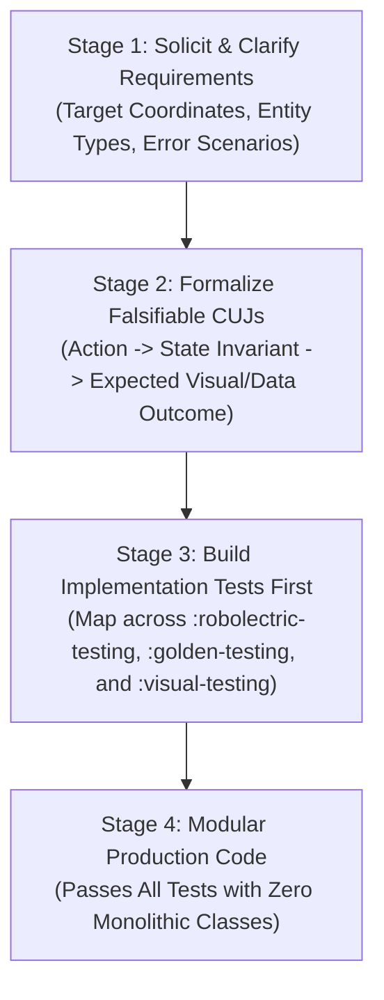

# Android Maps Testing Toolkit Guide (`android-maps-testing`)

You are an expert Google Maps Platform Android testing engineer, architect, and pair programmer. This skill provides procedural guidance, architectural standards, and verified, region-tagged recipes for testing Google Maps SDK applications across all supported testing paradigms in [`googlemaps/android-maps-testing`](https://github.com/googlemaps/android-maps-testing):

1. [**:robolectric-testing**](../../../robolectric-testing/README.md) — **Paradigm 1: Fast, Headless JVM Unit Testing**
   - **1A. Kotlin + Google Truth Domain Subjects**: `withTestMap { ... }`, `assertThat(map).isCenteredOn(...).hasMarkerWithTitle(...)`, `LatLngSubject`.
   - **1B. Kotlin + Kotlin Power-Assert (Zero Extra Dependencies)**: `withTestMap { ... }`, `assertMap(...)`, `marker.assertMarker(...)`, `assertGeo((a distanceTo b) <= 5.meters)`.
   - **1C. Java Headless JVM Testing**: `ShadowMapView`, `ShadowGoogleMap`, `LatLngSubject`, and 2D Mercator `Canvas` rendering.
   - **1D. Production Controllers, Activities, Jetpack Compose & Clustering**: Testing `StoreLocatorMapManager`, extracting `MapView` from Activity/Compose trees via `rootView.requireMapView().getMapBlocking()`, simulating `REASON_GESTURE` camera pans (`simulateUserCameraMove`), fitting bounds (`newLatLngBounds`), and testing `android-maps-utils` marker clustering.
2. [**:golden-testing**](../../../golden-testing/README.md) — **Paradigm 2: Deterministic Offline Golden Screenshot Testing**
   - 100% offline, zero-quota visual regression testing on JVM or Android devices. Injects deterministic synthetic tile providers (`CoordinateGrid`, `SolidColorHash`, `Checkerboard`, `Custom`) at `z-index = -1000` over `MAP_TYPE_NONE` (including `rememberGoldenTileProvider()` for Maps Compose). Features auto-idled `awaitMapLoaded()` and `captureSnapshot()`, 1-liner `assertMatchesGolden(goldenFile)`, `-Dmaps.golden.record=true` baseline recording, and automatic `<name>_actual.png` + `<name>_diff.png` failure diagnostic artifacts.
3. [**:visual-testing**](../../../visual-testing/README.md) — **Paradigm 3: Multimodal AI Visual Testing & Hybrid Golden Fallback**
   - Resilient connected-device visual verification powered by Google Gemini Vision (`BaseVisualTest`, `GeminiVisualTestHelper`). Combines a fast, zero-quota local pixel diff against committed test APK assets (`src/androidTest/assets/goldens/<testName>.png`) with automatic fallback to Gemini Flash semantic verification when anti-aliasing or dynamic cartography causes minor pixel divergence.

---

## Core Software Development Tenets

### 1. Test All Code & Mandate Test-Driven Development (TDD)
- **Zero Untested Code**: No map feature, manager, or UI flow is accepted without accompanying unit and integration tests verifying its correctness.
- **Strict TDD Workflow (Red &rarr; Green &rarr; Refactor)**:
  1. **Red**: Write a failing test first specifying expected camera state, marker placement, gesture response, or overlay drawing. Run the test and confirm it fails for the expected reason.
  2. **Green**: Write the minimal, cleanest production code required to satisfy the test.
  3. **Refactor**: Clean up the implementation, optimize performance, and enforce modularity while keeping tests 100% green.
- **High Branch & Function Coverage**: Explicitly test nominal flows and defensive edge cases:
  - Null/empty datasets passed to map controllers.
  - Boundary coordinates (antimeridian $\pm 180^\circ$, poles $\pm 90^\circ$).
  - Camera viewport bounds clamping (`setLatLngBoundsForCameraTarget`).
  - User gesture pans (`REASON_GESTURE`) vs. programmatic animations (`REASON_DEVELOPER_ANIMATION`).
  - Default SDK marker click behavior (listener returning `false` opens InfoWindow and centers camera) vs. consumed clicks (returning `true`) and single-active InfoWindow semantics.

👉 See [TDD & Critical User Journey Workflow](references/tdd_and_cuj_workflow.md) for full coverage guidelines.

---

### 2. Requirements &rarr; Critical User Journeys (CUJs) &rarr; Implementation Tests
Never write map UI or controller code in a vacuum. Execute this four-stage transformation:



---

### 3. Anti-Bloat Mandate: Strict Modularity (No Monolithic Classes)

> [!CAUTION]
> **Prohibition Against "God Classes"**:
> Agents must **NOT** create massive, monolithic source files (500–1000+ lines) combining UI, network, database, business logic, and map controllers. Monolithic classes violate the Single Responsibility Principle (SRP) and make unit testing impossible on host JVMs.

- **File Length Target**: Keep source files focused, cohesive, and under **200–300 lines**.
- **Clean Layer Separation**:
  - **UI Layer** (`MapActivity` / `MapScreen`): Presentation and view lifecycle only. Forwards touch events; observes ViewModel.
  - **State Holder** (`MapViewModel`): Exposes immutable `StateFlow<MapUiState>`.
    ⚠️ **CRITICAL: NEVER hold a reference to `GoogleMap`, `MapView`, `Marker`, or `Context` in a ViewModel!** Doing so causes immediate memory leaks across configuration changes.
  - **Domain Layer** (Use Cases): Pure Kotlin business logic and coordinate transformations with zero Android view dependencies.
  - **Map Controller Layer** (`StoreLocatorMapManager`): Dedicated delegate encapsulating direct `GoogleMap` SDK interactions. Tested on the JVM in milliseconds via `createTestMap()` / `withTestMap { ... }`.

👉 See [Modular Architecture & Anti-Bloat Guidelines](references/modular_architecture_and_anti_bloat.md) for full architectural patterns.

---

### 4. The Zero-Mock Reality Gap Mandate (Production UI Integration Gate)

> [!CAUTION]
> **Prohibition Against Isolated-Only Testing**:
> A critical failure mode is creating tests that instantiate synthetic, standalone `MapView` instances in isolated test fixtures while leaving production activities and screens (`MainActivity`, `MainScreen`) completely unverified or disconnected from the map.
> **A green test suite on synthetic test fixtures is NOT proof that the application works.**

- **Mandatory Production Map Assertions**:
  Every application must contain integration tests verifying that the map component (`MapView`, `SupportMapFragment`, or Compose `GoogleMap`) actually exists and is displayed in the production UI tree:
  ```kotlin
  // In Compose UI tests
  composeTestRule.onNodeWithTag("google_map").assertExists().assertIsDisplayed()

  // In Activity or Compose View hierarchy tests
  val mapView = activity.window.decorView.requireMapView()
  val map = mapView.getMapBlocking()
  ```

---

### 5. Single-Source-of-Truth Region Tags
When quoting code snippets in documentation or skills, only reference code surrounded with official region tags (`// [START <tag>]` ... `// [END <tag>]`) to ensure single-source-of-truth consistency across the codebase, READMEs, and skills.

---

## Which Testing Paradigm Should I Use?

```
                                  What are you testing?
                                            |
         +----------------------------------+----------------------------------+
         |                                                                     |
Behavioral / Functional                                                  UI / Rendering
         |                                                                     |
Do you need fast, headless                                       Do you need screenshot or visual
JVM execution without devices?                                    fidelity assertions?
         |                                                                     |
         v                                             +-----------------------+-----------------------+
[:robolectric-testing]                                 |                                               |
- 1-liner withTestMap { ... } harness          Deterministic Pixels                   AI Semantic / Resilient
- Camera moves, newLatLngBounds, scrollBy              |                                               |
- Marker clicks, InfoWindow, dragging                  v                                               v
- REASON_GESTURE user pan simulation           [:golden-testing]                               [:visual-testing]
- Assert with Google Truth or Power-Assert     - 100% offline & zero quota                 - Natural language assertions
                                               - Synthetic tiles on JVM & device           - Committed APK asset goldens
                                               - 1-liner assertMatchesGolden()             - Hybrid pixel + Gemini fallback
                                               - Auto _actual.png & _diff.png              - UiAutomator AI actions
```

👉 See [Decision Matrix & Module Overview](references/overview_and_decision_matrix.md) for full trade-offs.

---

## Installation

### Using Gradle Version Catalog (`gradle/libs.versions.toml`)

```toml
[versions]
mapsTesting = "1.0.0-rc01" # x-release-please-version
robolectric = "4.17"
truth = "1.4.5"

[libraries]
maps-testing-robolectric = { module = "com.google.maps.android:maps-testing-robolectric", version.ref = "mapsTesting" }
maps-testing-golden = { module = "com.google.maps.android:maps-testing-golden", version.ref = "mapsTesting" }
maps-testing-visual = { module = "com.google.maps.android:maps-testing-visual", version.ref = "mapsTesting" }
robolectric = { module = "org.robolectric:robolectric", version.ref = "robolectric" }
truth = { module = "com.google.truth:truth", version.ref = "truth" }
```

```kotlin
dependencies {
    // Paradigm 1: Headless JVM unit testing with Robolectric shadows
    testImplementation(libs.maps.testing.robolectric)
    testImplementation(libs.robolectric)
    testImplementation(libs.truth) // Optional if using Kotlin Power-Assert

    // Paradigm 2: Deterministic offline golden screenshot testing (JVM or androidTest)
    testImplementation(libs.maps.testing.golden)
    androidTestImplementation(libs.maps.testing.golden)

    // Paradigm 3: Multimodal AI visual testing & hybrid golden fallback (androidTest)
    androidTestImplementation(libs.maps.testing.visual)
}
```

---

## Paradigm Reference & Verified Sample Recipes

### Paradigm 1A: Headless JVM Map Testing with `withTestMap` & Google Truth (`:robolectric-testing`)

Use `withTestMap { ... }` to spin up a measured, laid-out, initialized `GoogleMap` in one line and assert state with `com.google.maps.android.robolectric.truth.assertThat`:

Reference: region `maps_robolectric_demo_test` in [`MapDemoTest.kt`](../../../app/src/test/java/com/example/androidmapsrobolectric/MapDemoTest.kt#L35-L81)

```kotlin
// [START maps_robolectric_demo_test]
@RunWith(MapsRobolectricTestRunner::class)
@GraphicsMode(GraphicsMode.Mode.NATIVE)
@Config(sdk = [34])
class MapDemoTest {

  @Test
  fun testMapOverlaysAndAssertions() = withTestMap(width = 200, height = 200) {
    // 1. Center the camera on Boulder, Colorado
    val boulder = LatLng(40.0150, -105.2705)
    moveCamera(CameraUpdateFactory.newLatLngZoom(boulder, 14f))

    // 2. Add a Marker with a tinted icon
    addMarker(
      MarkerOptions()
        .position(boulder)
        .title("Boulder, CO")
        .icon(BitmapDescriptorFactory.defaultMarker(BitmapDescriptorFactory.HUE_AZURE)),
    )

    // 3. Draw a Polygon around the area
    val northBoulderPark = LatLng(40.0185, -105.2705)
    addPolygon(
      PolygonOptions()
        .add(
          LatLng(40.0100, -105.2800),
          LatLng(40.0100, -105.2600),
          LatLng(40.0200, -105.2600),
          LatLng(40.0200, -105.2800),
        )
        .fillColor(Color.GREEN)
        .strokeColor(Color.DKGRAY)
        .strokeWidth(2f),
    )

    // 4. Simulate a user tapping the marker (opens InfoWindow by default)
    clickMarker("Boulder, CO")

    // 5. Assert geodesic camera position, active InfoWindow, and rendered canvas pixel
    assertThat(this)
      .isCenteredOn(boulder, tolerance = 5.meters)
      .hasZoom(14f)
      .hasActiveInfoWindowWithTitle("Boulder, CO")
      .hasPixelColorAt(northBoulderPark, Color.GREEN)
  }
}
// [END maps_robolectric_demo_test]
```

---

### Paradigm 1B: Headless JVM Map Testing with Kotlin Power-Assert (`:robolectric-testing`)

If you prefer plain boolean expressions with zero Google Truth dependency, import `assertMap`, `assertMarker`, `distanceTo`, and `meters` directly from `com.google.maps.android.robolectric.powerassert`:

Reference: region `maps_robolectric_power_assert` in [`LazyAssertionsComparisonTest.kt`](../../../robolectric-testing/src/test/java/com/google/maps/android/robolectric/shadows/LazyAssertionsComparisonTest.kt#L149-L185)

```kotlin
  // [START maps_robolectric_power_assert]
  @Test
  fun cameraAndMarkers_kotlinPowerAssertStyle() = withTestMap {
    moveCamera(CameraUpdateFactory.newLatLngZoom(boulder, 14f))

    val marker = addMarker(
      MarkerOptions()
        .position(boulder)
        .title("Boulder HQ")
        .snippet("Open")
        .draggable(true)
        .alpha(0.9f),
    )!!.apply {
      tag = "hq_1"
      showInfoWindow()
    }

    assertMap(
      (cameraTarget distanceTo boulder) <= 5.meters &&
        cameraZoom == 14f &&
        boulder in visibleBounds &&
        denver !in visibleBounds &&
        markers.size == 1 &&
        isInfoWindowShownFor("Boulder HQ"),
    )

    marker.assertMarker(
      (marker.position distanceTo boulder) <= 1.meters &&
        marker.title == "Boulder HQ" &&
        marker.snippet == "Open" &&
        marker.tag == "hq_1" &&
        marker.isDraggable &&
        marker.isVisible &&
        marker.isInfoWindowShown,
    )
  }
  // [END maps_robolectric_power_assert]
```

---

### Paradigm 1C: Testing Production Map Controllers & View Hierarchies (`:robolectric-testing`)

Pass the test `GoogleMap` from `createTestMap()` directly into your production controller (`StoreLocatorMapManager`), or locate an embedded `MapView` inside an `Activity` or Jetpack Compose screen via `requireMapView()`:

Reference: region `maps_robolectric_manager_test` in [`StoreLocatorMapManagerTest.kt`](../../../app/src/test/java/com/example/androidmapsrobolectric/manager/StoreLocatorMapManagerTest.kt#L36-L127)

```kotlin
// [START maps_robolectric_manager_test]
@RunWith(MapsRobolectricTestRunner::class)
@GraphicsMode(GraphicsMode.Mode.NATIVE)
@Config(sdk = [34])
class StoreLocatorMapManagerTest {

  private lateinit var googleMap: GoogleMap
  private val selectedStores = mutableListOf<Store>()
  private lateinit var manager: StoreLocatorMapManager

  private val boulderStore = Store(
    id = "store_boulder",
    name = "Boulder Flagship Store",
    location = LatLng(40.0150, -105.2705),
    isOpenNow = true,
  )

  private val denverStore = Store(
    id = "store_denver",
    name = "Denver Downtown Store",
    location = LatLng(39.7392, -104.9903),
    isOpenNow = false,
  )

  @Before
  fun setUp() {
    googleMap = createTestMap(width = 200, height = 200)
    manager = StoreLocatorMapManager(onStoreSelected = { selectedStores.add(it) })
    manager.attachMap(googleMap)
  }

  @Test
  fun testDisplayStores_createsMarkersWithCorrectMetadataAndTags() {
    manager.displayStores(listOf(boulderStore, denverStore))

    assertThat(googleMap).hasMarkerCount(2)
    assertThat(googleMap)
      .hasMarkerWithTitle("Boulder Flagship Store")
      .isAt(boulderStore.location, tolerance = 1.meters)
      .hasSnippet("Open now")
      .hasTag(boulderStore)

    assertThat(googleMap)
      .hasMarkerWithTitle("Denver Downtown Store")
      .hasSnippet("Closed")
      .hasTag(denverStore)
  }

  @Test
  fun testMarkerClick_selectsStoreAndShowsInfoWindow() {
    manager.displayStores(listOf(boulderStore, denverStore))

    // Simulate a user tapping the marker by title
    googleMap.clickMarker("Boulder Flagship Store")

    // Verify the manager notified the application listener and opened the InfoWindow
    truthAssertThat(selectedStores).containsExactly(boulderStore)
    assertThat(googleMap).hasActiveInfoWindowWithTitle("Boulder Flagship Store")
  }

  @Test
  fun testSelectStore_centersCameraAndOpensInfoWindow() {
    manager.displayStores(listOf(boulderStore, denverStore))

    val success = manager.selectStore("store_boulder")
    truthAssertThat(success).isTrue()

    assertThat(googleMap)
      .isCenteredOn(boulderStore.location, tolerance = 5.meters)
      .hasZoom(15f)
      .hasActiveInfoWindowWithTitle("Boulder Flagship Store")
  }

  @Test
  fun testClearStores_removesAllMarkersFromMap() {
    manager.displayStores(listOf(boulderStore, denverStore))
    assertThat(googleMap).hasMarkerCount(2)

    manager.clearStores()
    truthAssertThat(googleMap.markers).isEmpty()
    truthAssertThat(manager.getMarkerForStore("store_boulder")).isNull()
  }

  @Test
  fun testDeliveryPerimeter_rendersVisuallyOnCanvas() {
    googleMap.moveCamera(CameraUpdateFactory.newLatLngZoom(boulderStore.location, 14f))
    manager.setDeliveryPerimeter(boulderStore.location, 2000.0)

    assertThat(googleMap).hasNonBackgroundPixelAt(boulderStore.location)
  }
}
// [END maps_robolectric_manager_test]
```

Reference: region `robolectric_view_hierarchy_lookup` in [`ShadowMapViewKotlinTest.kt`](../../../robolectric-testing/src/test/java/com/google/maps/android/robolectric/shadows/ShadowMapViewKotlinTest.kt#L508-L518)

```kotlin
    // [START robolectric_view_hierarchy_lookup]
    // Locate the hosted MapView inside an Activity or Jetpack Compose view hierarchy
    val mapView = activity.window.decorView.requireMapView()
    val map = mapView.getMapBlocking()

    val seattle = LatLng(47.6062, -122.3321)
    map.moveCamera(CameraUpdateFactory.newLatLngZoom(seattle, 13f))
    GoogleMapSubject.assertThat(map)
      .isCenteredOn(seattle, tolerance = 5.meters)
      .hasZoom(13f)
    // [END robolectric_view_hierarchy_lookup]
```

---

### Paradigm 1D: Comprehensive Java Headless JVM Testing (`:robolectric-testing`)

Reference: region `maps_robolectric_java_demo_test` in [`MapViewDemoTest.java`](../../../app/src/test/java/com/example/androidmapsrobolectric/MapViewDemoTest.java#L86-L152)

```java
  // [START maps_robolectric_java_demo_test]
  @Test
  public void demoMapDrawingAndAssertions() {
    // 1. Size the MapView (100x100 pixels)
    mapView.measure(
        View.MeasureSpec.makeMeasureSpec(100, View.MeasureSpec.EXACTLY),
        View.MeasureSpec.makeMeasureSpec(100, View.MeasureSpec.EXACTLY));
    mapView.layout(0, 0, 100, 100);

    // 2. Initialize the MapView
    mapView.onCreate(new Bundle());

    // 3. Get the GoogleMap asynchronously
    final AtomicReference<GoogleMap> mapRef = new AtomicReference<>();
    mapView.getMapAsync(mapRef::set);
    ShadowLooper.idleMainLooper();
    GoogleMap map = mapRef.get();
    assertThat(map).isNotNull();

    // 4. Position the camera at (0,0) Zoom 0
    // At zoom 0, the entire world is 256x256 pixels.
    // Our 100x100 MapView will show the center portion of the world.
    // LatLng(0,0) will be projected exactly to the center of our view: (50, 50).
    map.moveCamera(CameraUpdateFactory.newLatLngZoom(new LatLng(0, 0), 0f));

    // 5. Add a Polygon covering LatLng(-10, -10) to LatLng(10, 10)
    // We fill it with GREEN and stroke it with RED.
    map.addPolygon(
        new PolygonOptions()
            .add(new LatLng(-10, -10), new LatLng(-10, 10), new LatLng(10, 10), new LatLng(10, -10))
            .fillColor(Color.GREEN)
            .strokeColor(Color.RED)
            .strokeWidth(1f));

    // 6. Add a Polyline crossing horizontally at Latitude 0
    // We color it BLUE.
    map.addPolyline(
        new PolylineOptions()
            .add(new LatLng(0, -20), new LatLng(0, 20))
            .color(Color.BLUE)
            .width(2f));

    // 7. Render the MapView to a Bitmap
    Bitmap bitmap = Bitmap.createBitmap(100, 100, Bitmap.Config.ARGB_8888);
    Canvas canvas = new Canvas(bitmap);
    mapView.draw(canvas);

    // 8. Assertions using Google Truth

    // A: The center (50,50) corresponds to LatLng(0,0) which is on the Polyline.
    // Since Polyline is drawn on top of Polygon, it should be BLUE.
    assertThat(bitmap.getPixel(50, 50)).isEqualTo(Color.BLUE);

    // B: LatLng(5,0) projects to (50, Y) where Y < 50 (North of equator, Y decreases upwards in
    // Android).
    // This point is inside the Polygon but not on the Polyline. It should be GREEN.
    Point pVal = map.getProjection().toScreenLocation(new LatLng(5, 0));
    assertThat(pVal.x).isEqualTo(50);
    assertThat(pVal.y).isLessThan(50);
    assertThat(bitmap.getPixel(pVal.x, pVal.y)).isEqualTo(Color.GREEN);

    // C: A point far away (e.g. top-left corner at 5,5) should be outside the polygon.
    // It should show the map background color (LTGRAY).
    assertThat(bitmap.getPixel(5, 5)).isEqualTo(Color.LTGRAY);
  }
  // [END maps_robolectric_java_demo_test]
```

---

### Paradigm 2: Deterministic Golden Screenshot Testing (`:golden-testing`)

Use `enableGoldenTesting(...)` to replace live Google tiles with deterministic synthetic tiles (`CoordinateGrid`, `SolidColorHash`, `Checkerboard`, or `Custom`) and verify renders with `captureSnapshot()`, `assertMatchesGolden(goldenFile)`, or `GoldenImageDiff.assertMatches(...)`:

Reference: region `maps_sample_golden_map_test` in [`SampleGoldenMapTest.kt`](../../../golden-testing/src/test/java/com/google/maps/android/testing/golden/sample/SampleGoldenMapTest.kt#L45-L126)

```kotlin
// [START maps_sample_golden_map_test]
/**
 * Sample test suite demonstrating deterministic golden screenshot testing with Google Maps.
 *
 * In this pattern:
 * 1. The map is set to `MAP_TYPE_NONE` and backed by a deterministic synthetic tile provider.
 * 2. Overlays (circles, polygons, markers) are added to the map.
 * 3. The map snapshot is captured via [GoogleMap.captureSnapshot].
 * 4. The rendered snapshot is verified against a baseline using [GoldenImageDiff.assertMatches].
 */
@RunWith(MapsRobolectricTestRunner::class)
@GraphicsMode(GraphicsMode.Mode.NATIVE)
@Config(sdk = [34])
public class SampleGoldenMapTest {

  private lateinit var googleMap: GoogleMap

  @Before
  public fun setUp() {
    googleMap = createTestMap(width = 200, height = 200)

    // Enable deterministic golden tiles
    googleMap.enableGoldenTesting(strategy = GoldenTileStrategy.SolidColorHash())
  }

  @Test
  public fun sample_mapRenderingIsDeterministicAcrossRepeatedCaptures() = runTest {
    googleMap.moveCamera(CameraUpdateFactory.newLatLngZoom(LatLng(37.7749, -122.4194), 10f))
    googleMap.addCircle(
      CircleOptions()
        .center(LatLng(37.7749, -122.4194))
        .radius(5000.0)
        .fillColor(Color.RED)
        .strokeWidth(0f),
    )

    // First capture (acts as baseline)
    val baselineSnapshot = googleMap.captureSnapshot()

    // Second capture under identical state
    val secondSnapshot = googleMap.captureSnapshot()

    // Should match exactly (0% pixel diff)
    GoldenImageDiff.assertMatches(
      expected = baselineSnapshot,
      actual = secondSnapshot,
      maxDiffPercentage = 0.0,
      message = "Repeated map captures must be 100% pixel identical",
    )
  }

  @Test
  public fun sample_visualRegressionIsDetectedWhenOverlayColorChanges() = runTest {
    val center = LatLng(0.0, 0.0)
    googleMap.moveCamera(CameraUpdateFactory.newLatLngZoom(center, 5f))

    // Baseline render with BLUE polygon
    val polygon = checkNotNull(
      googleMap.addPolygon(
        PolygonOptions()
          .add(LatLng(-5.0, -5.0), LatLng(-5.0, 5.0), LatLng(5.0, 5.0), LatLng(5.0, -5.0))
          .fillColor(Color.BLUE)
          .strokeWidth(0f),
      ),
    )

    val baselineSnapshot = googleMap.captureSnapshot()

    // Introduce visual regression: change fill color to GREEN
    polygon.fillColor = Color.GREEN
    val modifiedSnapshot = googleMap.captureSnapshot()

    // Verify that GoldenImageDiff flags the visual regression
    val diff = GoldenImageDiff.compare(baselineSnapshot, modifiedSnapshot)
    assertThat(diff.matches).isFalse()
    assertThat(diff.diffPixelCount).isGreaterThan(0)

    assertThrows(AssertionError::class.java) {
      GoldenImageDiff.assertMatches(baselineSnapshot, modifiedSnapshot, maxDiffPercentage = 0.0)
    }
  }
// [END maps_sample_golden_map_test]
```

Reference: region `golden_diff_artifacts_and_record` in [`GoldenImageDiffTest.kt`](../../../golden-testing/src/test/java/com/google/maps/android/testing/golden/GoldenImageDiffTest.kt#L109-L146)

```kotlin
    // [START golden_diff_artifacts_and_record]
    val baseline = createSolidBitmap(16, 16, Color.BLUE)
    val matchingActual = createSolidBitmap(16, 16, Color.BLUE)
    val regressedActual = createSolidBitmap(16, 16, Color.BLUE).apply {
      setPixel(8, 8, Color.YELLOW)
    }

    // 1. Record the baseline PNG (or run Gradle with -Dmaps.golden.record=true)
    GoldenImageDiff.assertMatches(
      goldenFile = goldenFile,
      actual = baseline,
      recordBaseline = true,
    )
    assertThat(goldenFile.exists()).isTrue()

    // 2. Compare matching render against the recorded golden PNG
    GoldenImageDiff.assertMatches(
      goldenFile = goldenFile,
      actual = matchingActual,
      maxDiffPercentage = 0.0,
    )

    // 3. When a regression occurs, <name>_actual.png and <name>_diff.png are automatically written
    val failure = assertThrows(AssertionError::class.java) {
      GoldenImageDiff.assertMatches(
        goldenFile = goldenFile,
        actual = regressedActual,
        maxDiffPercentage = 0.0,
        outputDir = outDir,
      )
    }

    val actualArtifact = File(outDir, "route_overlay_actual.png")
    val diffArtifact = File(outDir, "route_overlay_diff.png")
    assertThat(actualArtifact.exists()).isTrue()
    assertThat(diffArtifact.exists()).isTrue()
    assertThat(failure.message).contains(diffArtifact.path)
    // [END golden_diff_artifacts_and_record]
```

---

### Paradigm 3: Multimodal AI Visual Testing & Hybrid Golden Fallback (`:visual-testing`)

Extend `BaseVisualTest` and call `verifyScreenshotWithGoldenFallback(...)`. On clean emulators or CI, `BaseVisualTest` checks bundled test APK assets (`src/androidTest/assets/goldens/<testName>.png`) first for an instant zero-quota fast pass, and only consults Gemini Vision when no baseline exists yet or pixel diff exceeds `tolerancePercent`:

Reference: region `maps_visual_test_sample` in [`VisualMapSampleTest.kt`](../../../app/src/androidTest/java/com/example/androidmapsrobolectric/VisualMapSampleTest.kt#L28-L71)

```kotlin
// [START maps_visual_test_sample]
/**
 * Sample instrumented visual test demonstrating AI-powered visual verification
 * and hybrid golden testing with Gemini.
 */
@RunWith(AndroidJUnit4::class)
class VisualMapSampleTest : BaseVisualTest() {

  @Test
  fun verifyStoreLocatorMapRendering() = runBlocking {
    // 1. Launch MainActivity
    val intent = Intent(context, MainActivity::class.java).apply {
      addFlags(Intent.FLAG_ACTIVITY_NEW_TASK or Intent.FLAG_ACTIVITY_CLEAR_TASK)
    }
    context.startActivity(intent)

    // 2. Wait for application window to settle
    uiDevice.wait(Until.hasObject(By.pkg(context.packageName).depth(0)), 10000)
    waitForMapRendering(timeoutSeconds = 5)

    // 3. Capture screenshot of current map state
    val screenshotBitmap = captureScreenshot("store_locator_screenshot.png")

    // 4. Natural language prompt specifying expected visual elements
    val prompt = """
            Please act as a UI tester and analyze this screenshot of an Android application.
            Verify the following criteria:
            1. Confirm that the application displays a Google Map surface with the "Store Locator" header.
            2. Confirm that store location pins or map tiles are visible on the screen.
            3. Confirm that the application interface has rendered cleanly without error banners, blank crash dialogs, or ANRs.

            If all criteria are met, reply with "PASSED".
            If any criteria is not met, please detail the discrepancy.
    """.trimIndent()

    // 5. Hybrid verification: check local golden baseline first, fallback to Gemini Vision
    verifyScreenshotWithGoldenFallback(
      testName = "store_locator_initial_state",
      screenshotBitmap = screenshotBitmap,
      prompt = prompt,
    )
  }
}
// [END maps_visual_test_sample]
```

---

## Detailed References

For specialized architecture, advanced shadow behaviors, and paradigm deep-dives, refer to the in-depth guides:

1. [**TDD & Critical User Journey (CUJ) Workflow**](references/tdd_and_cuj_workflow.md): The mandatory Red &rarr; Green &rarr; Refactor lifecycle, edge-case coverage matrix, and CUJ-to-test mapping.
2. [**Modular Architecture & Anti-Bloat Guidelines**](references/modular_architecture_and_anti_bloat.md): The anti-bloat mandate (< 200–300 lines), SRP, clean layer separation, and isolating `GoogleMap` in controllers (`StoreLocatorMapManager`).
3. [**Overview & Decision Matrix**](references/overview_and_decision_matrix.md): In-depth comparison of execution speed, offline capabilities, quota impact, and module selection.
4. [**Robolectric Shadows & JVM Testing**](references/robolectric_shadows_and_jvm_testing.md): Complete shadow reference, `withTestMap` / `createTestMap`, Google Truth vs. Kotlin Power-Assert, `newLatLngBounds` & `scrollBy`, default `clickMarker` & single-active `InfoWindow`, `simulateUserCameraMove` (`REASON_GESTURE`), styling/bounds clamping, and `requireMapView()`.
5. [**Golden Image Testing**](references/golden_image_testing.md): Synthetic tile generation, strategy selection, `awaitMapLoaded()`, `captureSnapshot()`, 1-liner `assertMatchesGolden()`, `-Dmaps.golden.record=true`, and `_actual.png`/`_diff.png` failure artifacts.
6. [**AI Visual Testing & Gemini Vision**](references/ai_visual_testing_and_gemini.md): Dynamic model resolution, 3-step hybrid golden lifecycle (`src/androidTest/assets/goldens/`), prompt design, and UiAutomator AI actions.
7. [**Jetpack Compose & Ecosystem Bridges**](references/jetpack_compose_and_ecosystem.md): Declarative Compose map testing (`rememberGoldenTileProvider()`, `findMapView()`), `android-maps-utils` marker clustering algorithm testing, and KTX extensions.

---

## Ready-to-Use Templates

- [**`RobolectricMapTestTemplate.kt`**](assets/templates/RobolectricMapTestTemplate.kt): Headless JVM unit test template using `withTestMap`, `assertThat(map)`, and user interaction simulation.
- [**`GoldenMapTestTemplate.kt`**](assets/templates/GoldenMapTestTemplate.kt): Deterministic offline golden screenshot test template using `enableGoldenTesting` and `assertMatchesGolden`.
- [**`VisualMapTestTemplate.kt`**](assets/templates/VisualMapTestTemplate.kt): AI-driven multimodal visual test template with hybrid golden fallback.
