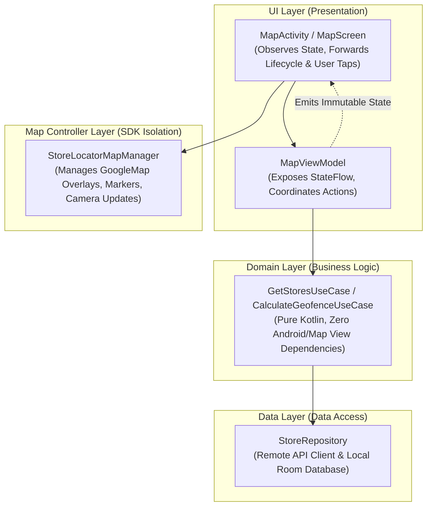

# Modular Architecture & Anti-Bloat Guidelines

This guide establishes the architectural invariants and structural constraints for building maintainable, testable, and cleanly modularized Google Maps Android applications using the Android Maps Testing Toolkit (`android-maps-testing`).

---

## 1. The Anti-Bloat Mandate: No Monolithic "God Classes"

> [!CAUTION]
> **Strict Prohibition Against Monolithic "God Classes"**:
> A frequent failure mode of AI coding agents is dumping map initialization, marker management, cluster logic, network API fetching, Room database caching, business rules, and UI event listeners into a single massive Activity, Fragment, or Screen spanning 500–1000+ lines. **DO NOT DO THIS.**
> Monolithic classes violate the Single Responsibility Principle (SRP), make unit testing impossible on host JVMs, and create brittle, untestable codebases.

### Structural Guidelines
- **File Length Target**: Keep source files focused, cohesive, and under **200–300 lines**.
- **Single Responsibility Principle (SRP)**: Each class must have exactly one reason to change.
- **One Primary Class Per File**: Never bundle data transfer objects, enums, view controllers, and utility extensions in one file.
- **Dedicated Map Controllers**: Always extract direct Maps SDK calls (`GoogleMap`, `Marker`, `Polygon`, `CameraUpdate`) into a standalone controller or delegate.

---

## 2. Modern Android Architecture (MAD) Layering

Architect your map application into distinct, unidirectional layers:



---

## 3. Strict Layer Invariants

### A. UI Layer (`MapActivity` / `MapScreen`)
- **Role**: Pure presentation and Android lifecycle forwarding.
- **Responsibilities**:
  - Hosts `MapView`, `SupportMapFragment`, or Compose `GoogleMap`.
  - Forwards lifecycle events (`onCreate`, `onResume`, `onDestroy`) to `MapView`.
  - Subscribes to `MapViewModel.uiState` using `repeatOnLifecycle`.
  - Hands the ready `GoogleMap` instance to the Map Controller.
- **Strict Invariants**:
  - ❌ **NO network requests or database queries.**
  - ❌ **NO geodesic math or business validation logic.**
  - ❌ **NO direct state mutation.**

### B. State Holder (`MapViewModel`)
- **Role**: Holds business and presentation state; orchestrates use cases.
- **Responsibilities**:
  - Exposes an immutable `StateFlow<MapUiState>` (e.g. `Loading`, `Success(stores, cameraTarget)`, `Error`).
  - Processes UI intents and triggers domain use cases.
- **Strict Invariants**:
  - ⚠️ **CRITICAL: NEVER hold a reference to `GoogleMap`, `MapView`, `Marker`, or `Context` in a ViewModel!** Doing so causes immediate, catastrophic memory leaks across configuration changes and process recreations.
  - ViewModels operate strictly on domain models and immutable data structures (e.g., `LatLng`, entity IDs).

### C. Domain Layer (Use Cases)
- **Role**: Pure business logic and domain rules.
- **Responsibilities**:
  - Encapsulates single operations (e.g., `FilterNearbyStoresUseCase`, `ValidateGeofenceBoundaryUseCase`).
  - Implements pure geometric or coordinate algorithms without UI dependencies.
- **Strict Invariants**:
  - ❌ **Zero dependencies on `com.google.android.gms.maps.*` view types or Android UI framework.**

### D. Map Controller Layer (`StoreLocatorMapManager`)
- **Role**: Dedicated delegate encapsulating direct `GoogleMap` SDK interactions.
- **Responsibilities**:
  - Attaches to `GoogleMap`, configures UI settings (`isZoomControlsEnabled`, `isCompassEnabled`).
  - Manages marker collections, polylines, polygons, and info window adapters.
  - Exposes clean callbacks (e.g. `onStoreSelected: (Store) -> Unit`).
- **Testing Benefit**:
  - Can be tested completely on the local host JVM in milliseconds using `:robolectric-testing` shadows (`createTestMap()` / `withTestMap { ... }`) without launching an activity or emulator!

---

## 4. Production Map Controller Implementation

Reference: `// [START maps_robolectric_manager]` in [`StoreLocatorMapManager.kt`](../../../../app/src/main/java/com/example/androidmapsrobolectric/manager/StoreLocatorMapManager.kt#L31-L157)

```kotlin
// [START maps_robolectric_manager]
/**
 * Production map manager that coordinates store locator map overlays, camera positioning,
 * and user tap interactions on a GoogleMap instance.
 */
class StoreLocatorMapManager(
  private val onStoreSelected: ((Store) -> Unit)? = null,
) {
  private var googleMap: GoogleMap? = null
  private val storeMarkers = mutableMapOf<String, Marker>()
  private var deliveryZoneCircle: Circle? = null
  var isSearchThisAreaVisible: Boolean = false
    private set

  /**
   * Attaches and configures the [GoogleMap] instance with UI controls and click listeners.
   */
  fun attachMap(map: GoogleMap) {
    this.googleMap = map
    map.uiSettings.isZoomControlsEnabled = true
    map.uiSettings.isCompassEnabled = true

    map.setOnCameraMoveStartedListener { reason ->
      if (reason == GoogleMap.OnCameraMoveStartedListener.REASON_GESTURE) {
        isSearchThisAreaVisible = true
      }
    }

    map.setOnMarkerClickListener { marker ->
      val store = marker.tag as? Store
      if (store != null) {
        onStoreSelected?.invoke(store)
      }
      // Return false so the Maps SDK performs its default behavior:
      // automatically opening the marker's InfoWindow and centering the camera.
      false
    }
  }

  /**
   * Renders a collection of [Store] locations as markers on the map, color-coded by open status.
   */
  fun displayStores(stores: List<Store>) {
    val map = googleMap ?: return
    clearStores()

    for (store in stores) {
      val hue = if (store.isOpenNow) {
        BitmapDescriptorFactory.HUE_AZURE
      } else {
        BitmapDescriptorFactory.HUE_RED
      }

      val markerOptions = MarkerOptions()
        .position(store.location)
        .title(store.name)
        .snippet(if (store.isOpenNow) "Open now" else "Closed")
        .icon(BitmapDescriptorFactory.defaultMarker(hue))

      val marker = map.addMarker(markerOptions)
      if (marker != null) {
        marker.tag = store
        storeMarkers[store.id] = marker
      }
    }
  }

  /**
   * Selects a store by ID, centering the map camera on its location and displaying its info window.
   */
  fun selectStore(storeId: String): Boolean {
    val marker = storeMarkers[storeId] ?: return false
    val map = googleMap ?: return false

    map.animateCamera(CameraUpdateFactory.newLatLngZoom(marker.position, 15f))
    marker.showInfoWindow()
    val store = marker.tag as? Store
    if (store != null) {
      onStoreSelected?.invoke(store)
    }
    return true
  }

  /**
   * Draws a delivery service perimeter circle around a store coordinate.
   */
  fun setDeliveryPerimeter(center: LatLng, radiusMeters: Double) {
    val map = googleMap ?: return
    deliveryZoneCircle?.remove()

    deliveryZoneCircle = map.addCircle(
      CircleOptions()
        .center(center)
        .radius(radiusMeters)
        .fillColor(Color.argb(70, 0, 150, 255))
        .strokeColor(Color.BLUE)
        .strokeWidth(2f),
    )
  }

  /**
   * Fits all currently displayed store markers on screen using [CameraUpdateFactory.newLatLngBounds].
   */
  fun fitAllStores(paddingPx: Int = 64): Boolean {
    val map = googleMap ?: return false
    if (storeMarkers.isEmpty()) return false
    val boundsBuilder = LatLngBounds.builder()
    for (marker in storeMarkers.values) {
      boundsBuilder.include(marker.position)
    }
    map.animateCamera(CameraUpdateFactory.newLatLngBounds(boundsBuilder.build(), paddingPx))
    return true
  }

  /**
   * Clears all store markers from the map.
   */
  fun clearStores() {
    for (marker in storeMarkers.values) {
      marker.remove()
    }
    storeMarkers.clear()
  }

  fun getMarkerForStore(storeId: String): Marker? = storeMarkers[storeId]
}
// [END maps_robolectric_manager]
```

---

## 5. Testing the Controller on JVM with `createTestMap` & Domain Assertions

Reference: `// [START maps_robolectric_manager_test]` in [`StoreLocatorMapManagerTest.kt`](../../../../app/src/test/java/com/example/androidmapsrobolectric/manager/StoreLocatorMapManagerTest.kt#L37-L129)

```kotlin
// [START maps_robolectric_manager_test]
@RunWith(RobolectricTestRunner::class)
@GraphicsMode(GraphicsMode.Mode.NATIVE)
@Config(sdk = [34])
@EnableMapsShadows
class StoreLocatorMapManagerTest {

  private lateinit var googleMap: GoogleMap
  private val selectedStores = mutableListOf<Store>()
  private lateinit var manager: StoreLocatorMapManager

  private val boulderStore = Store(
    id = "store_boulder",
    name = "Boulder Flagship Store",
    location = LatLng(40.0150, -105.2705),
    isOpenNow = true,
  )

  private val denverStore = Store(
    id = "store_denver",
    name = "Denver Downtown Store",
    location = LatLng(39.7392, -104.9903),
    isOpenNow = false,
  )

  @Before
  fun setUp() {
    googleMap = createTestMap(width = 200, height = 200)
    manager = StoreLocatorMapManager(onStoreSelected = { selectedStores.add(it) })
    manager.attachMap(googleMap)
  }

  @Test
  fun testDisplayStores_createsMarkersWithCorrectMetadataAndTags() {
    manager.displayStores(listOf(boulderStore, denverStore))

    assertThat(googleMap).hasMarkerCount(2)
    assertThat(googleMap)
      .hasMarkerWithTitle("Boulder Flagship Store")
      .isAt(boulderStore.location, tolerance = 1.meters)
      .hasSnippet("Open now")
      .hasTag(boulderStore)

    assertThat(googleMap)
      .hasMarkerWithTitle("Denver Downtown Store")
      .hasSnippet("Closed")
      .hasTag(denverStore)
  }

  @Test
  fun testMarkerClick_selectsStoreAndShowsInfoWindow() {
    manager.displayStores(listOf(boulderStore, denverStore))

    // Simulate a user tapping the marker by title
    googleMap.clickMarker("Boulder Flagship Store")

    // Verify the manager notified the application listener and opened the InfoWindow
    truthAssertThat(selectedStores).containsExactly(boulderStore)
    assertThat(googleMap).hasActiveInfoWindowWithTitle("Boulder Flagship Store")
  }

  @Test
  fun testSelectStore_centersCameraAndOpensInfoWindow() {
    manager.displayStores(listOf(boulderStore, denverStore))

    val success = manager.selectStore("store_boulder")
    truthAssertThat(success).isTrue()

    assertThat(googleMap)
      .isCenteredOn(boulderStore.location, tolerance = 5.meters)
      .hasZoom(15f)
      .hasActiveInfoWindowWithTitle("Boulder Flagship Store")
  }

  @Test
  fun testClearStores_removesAllMarkersFromMap() {
    manager.displayStores(listOf(boulderStore, denverStore))
    assertThat(googleMap).hasMarkerCount(2)

    manager.clearStores()
    truthAssertThat(googleMap.markers).isEmpty()
    truthAssertThat(manager.getMarkerForStore("store_boulder")).isNull()
  }

  @Test
  fun testDeliveryPerimeter_rendersVisuallyOnCanvas() {
    googleMap.moveCamera(CameraUpdateFactory.newLatLngZoom(boulderStore.location, 14f))
    manager.setDeliveryPerimeter(boulderStore.location, 2000.0)

    assertThat(googleMap).hasNonBackgroundPixelAt(boulderStore.location)
  }
}
// [END maps_robolectric_manager_test]
```
