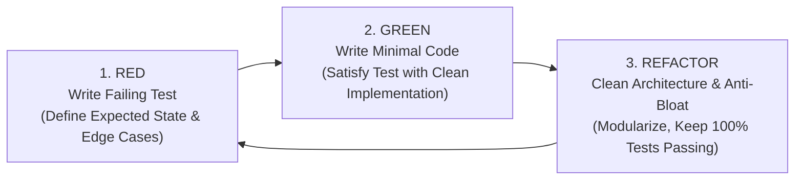
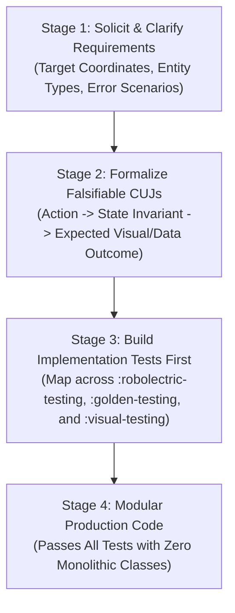

# Test-Driven Development (TDD) & Critical User Journey (CUJ) Workflow

This guide details the mandatory testing workflow, requirement transformation process, and edge-case coverage standards when developing Google Maps Android features with the Android Maps Testing Toolkit (`android-maps-testing`).

---

## 1. Test-Driven Development (TDD) as the Standard Workflow

Engineers and AI agents must adopt **strict Test-Driven Development (TDD)** for every map feature, manager, and custom overlay:



### The Three TDD Phases
1. **Red (Failing Test First)**:
   - Write a unit or integration test *before* implementing any production code.
   - Assert the expected camera target, zoom level, marker presence, info window content, or overlay color.
   - Run the test and confirm it fails for the expected reason (e.g., class missing, feature not yet implemented).
2. **Green (Minimal Production Code)**:
   - Implement the minimum amount of production code required to make the failing test pass.
   - Avoid speculative or dead code.
3. **Refactor (Clean & Modularize)**:
   - Restructure code into cohesive controllers, use cases, or composables.
   - Enforce file length targets (< 200–300 lines) and SRP.
   - Re-run the test suite to guarantee zero regressions.

---

## 2. Comprehensive Coverage & Edge-Case Matrix

"Test all code" requires high function and branch coverage. You must explicitly test both happy paths and defensive edge cases:

| Category | Edge Case Condition | Expected Behavior & Assertion Pattern |
| :--- | :--- | :--- |
| **Null & Empty State** | Empty store/marker list passed to manager. | Clears all existing markers from `GoogleMap`; does not crash or leave stale pins. |
| **Boundary Coordinates** | Coordinates at antimeridian (180°/-180°) or poles (90°/-90°). | Validates camera bounds clamping; ensures projection does not produce `NaN` or crash. |
| **Camera Viewport Clamping**| User pans outside authorized operational zone. | Camera movement is restricted within `LatLngBounds` via `setLatLngBoundsForCameraTarget`. |
| **User Gesture vs. Animation** | User drags map (`REASON_GESTURE`) vs. code calls `animateCamera`. | `simulateUserCameraMove` reveals "Search this area" button; programmatic move keeps follow mode active. |
| **Offline & Network Loss** | Network connection drops during search/tile fetch. | In golden tests, synthetic tiles continue rendering uninterrupted; in app, displays cached Room data. |
| **Lifecycle Interruption** | MapView paused/stopped mid-animation; activity recreated. | Cancels pending coroutine scopes; restores camera position and selected marker state cleanly. |

---

## 3. Requirements &rarr; Critical User Journeys (CUJs) &rarr; Implementation Tests

Execute this four-stage transformation for every feature request:



### Stage 3: Map CUJs Across the 3 Testing Tiers

| Critical User Journey (CUJ) | Optimal Testing Tier | Implementation Mechanism |
| :--- | :--- | :--- |
| **CUJ-1 (Camera Initialization & Bounds Fitting)** | **Behavioral (`:robolectric-testing`)** | Local JVM test using `withTestMap` and `assertThat(map).isCenteredOn(boulder, 5.meters)`. |
| **CUJ-2 (Marker Population & Filtering)** | **Behavioral (`:robolectric-testing`)** | JVM test asserting `assertThat(map).hasMarkerCount(2).hasMarkerWithTitle(...)`. |
| **CUJ-3 (Marker Tap & Single Info Window)** | **Behavioral (`:robolectric-testing`)** | JVM test invoking `map.clickMarker("Boulder Flagship Store")` and verifying `hasActiveInfoWindowWithTitle(...)`. |
| **CUJ-4 (Polygon Geometry & Visual Regressions)** | **Deterministic Pixels (`:golden-testing`)** | Golden test using `enableGoldenTesting(CoordinateGrid())` and `assertMatchesGolden(goldenFile)`. |
| **CUJ-5 (End-to-End Screen Visual Presentation)** | **Semantic / AI (`:visual-testing`)** | Connected test using `verifyScreenshotWithGoldenFallback()` with committed `src/androidTest/assets/goldens/` baseline. |

---

## 4. The Zero-Mock Reality Gap Mandate (Production UI Integration Gate)

> [!CAUTION]
> **Prohibition Against Isolated-Only Testing**:
> A critical failure mode is creating tests that instantiate synthetic, standalone `MapView` instances in isolated test fixtures while leaving production activities and screens (`MainActivity`, `MainScreen`) completely unverified or disconnected from the map.
> **A green test suite on synthetic test fixtures is NOT proof that the application works.**

### Rules for Production UI Verification:
1. **Never Accept Placeholder Assertions**:
   - Tests asserting template scaffolding (such as `onNodeWithText("Hello Android!")`) while the app is supposed to display a map are **strictly prohibited**.
   - UI tests must verify the presence of actual map UI components:
     ```kotlin
     // In Compose UI tests
     composeTestRule.onNodeWithTag("google_map").assertExists().assertIsDisplayed()

     // In View hierarchy tests
     val mapView = activity.window.decorView.requireMapView()
     val map = mapView.getMapBlocking()
     ```
2. **Wire the Production Controller**:
   - Ensure the production map controller (`StoreLocatorMapManager`) is attached to the actual `MapView` hosted by the activity or composable.
3. **Verify Manifest & Permissions**:
   - Production manifests must declare `com.google.android.geo.API_KEY`, `android.permission.INTERNET`, and `android.permission.ACCESS_NETWORK_STATE`.
