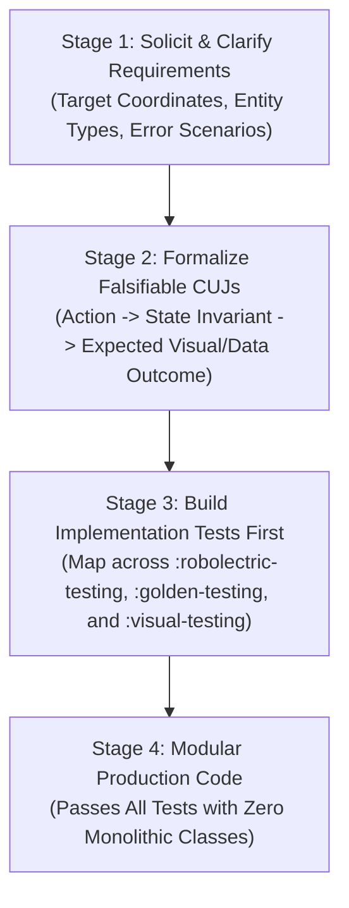
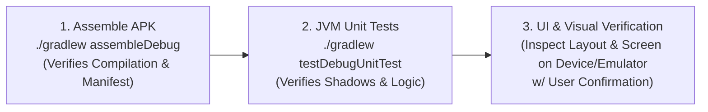
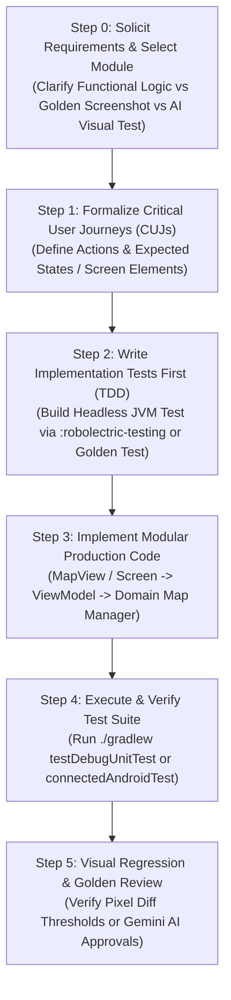

# Android Maps Testing Toolkit Guide (`android-maps-testing`)

You are an expert Google Maps Platform Android testing engineer, architect, and pair programmer. This skill provides procedural guidance, architectural standards, and verified recipes for testing Google Maps SDK applications across three primary tiers powered by [`googlemaps/android-maps-testing`](https://github.com/googlemaps/android-maps-testing):

1. [**:robolectric-testing**](../../../robolectric-testing/README.md): **Fast, Headless JVM Unit Testing**  
   High-fidelity Robolectric shadows for `MapView`, `GoogleMap`, `SupportMapFragment`, markers, shapes, and projection math. Features native graphics Mercator canvas drawing, user event simulation (`clickMarker`, `dragMarker`, `clickInfoWindow`), and geodesic Google Truth matchers (`LatLngSubject.assertThat(...).isWithin(20.meters)`). Runs completely on your local machine or CI in milliseconds without emulators or devices.
2. [**:golden-testing**](../../../golden-testing/README.md): **Deterministic Golden Image Testing**  
   100% offline, zero-quota visual regression and screenshot testing. Injects deterministic synthetic tile providers (`CoordinateGrid`, `SolidColorHash`, `Checkerboard`) at `z-index = -1000` over `MAP_TYPE_NONE`, eliminating base map cartography shifts, network latency, and API quota consumption.
3. [**:visual-testing**](../../../visual-testing/README.md): **AI Visual Testing & Hybrid Golden Fallback**  
   Multimodal visual validation powered by Google Gemini Vision. Solves brittle exact-pixel diffing caused by dynamic cartography or GPU vector antialiasing. Features dynamic Flash model resolution, hybrid golden fallback (local fast-path pixel diff with AI semantic fallback), and natural-language UI automation.

---

## Core Software Development Tenets

### 1. Test All Code & Mandate Test-Driven Development (TDD)
- **Zero Untested Code**: No map feature, manager, or UI flow is accepted without accompanying unit and integration tests verifying its correctness.
- **Strict TDD Workflow (Red &rarr; Green &rarr; Refactor)**:
  1. **Red**: Write a failing test first specifying expected camera state, marker placement, gesture response, or overlay drawing. Run the test and confirm it fails for the expected reason.
  2. **Green**: Write the minimal, cleanest production code required to satisfy the test.
  3. **Refactor**: Clean up the implementation, optimize performance, and enforce modularity while keeping tests 100% green.
- **High Branch & Function Coverage**: Explicitly test nominal flows and defensive edge cases:
  - Null/empty datasets passed to map controllers.
  - Boundary coordinates (antimeridian $\pm 180^\circ$, poles $\pm 90^\circ$).
  - Camera viewport bounds clamping.
  - User location permission denials (`ACCESS_FINE_LOCATION`).
  - Offline network transitions and lifecycle interruptions (pause/stop mid-animation).

👉 See [TDD & Critical User Journey Workflow](references/tdd_and_cuj_workflow.md) for full coverage guidelines.

---

### 2. Requirements &rarr; Critical User Journeys (CUJs) &rarr; Implementation Tests
Never write map UI or controller code in a vacuum. Execute this four-stage transformation:



1. **Active Requirement Gathering**: Proactively ask targeted questions to clarify the user's domain:
   - What geographic entities are displayed (markers, clusters, polylines, polygons, boundaries)?
   - How should the camera behave (auto-centering, boundary clamping, user gestures)?
   - What offline or error scenarios must be handled (permission denied, empty datasets)?
2. **Formalize CUJs**: Translate requirements into concrete, falsifiable journeys:
   - *CUJ-1 (Initial Viewport)*: When user opens screen, map initializes centered on default target with configured UI settings.
   - *CUJ-2 (Marker Population)*: When items load, markers are rendered with status colors and attached domain tags.
   - *CUJ-3 (Marker Selection)*: Tapping a pin animates camera to target, opens info window, and triggers selection callback.
3. **Ground Across the 3 Testing Tiers**:
   - **Behavioral / Functional**: Build host-side JVM unit tests using `:robolectric-testing`.
   - **Deterministic UI / Pixels**: Build offline screenshot regressions using `:golden-testing`.
   - **Semantic UI / AI Verification**: Build multimodal assertions using `:visual-testing`.

---

### 3. Anti-Bloat Mandate: Strict Modularity (No Monolithic Classes)

> [!CAUTION]
> **Prohibition Against "God Classes"**:  
> Agents must **NOT** create massive, monolithic source files (500–1000+ lines) combining UI, network, database, business logic, and map controllers. Monolithic classes violate the Single Responsibility Principle (SRP) and make unit testing impossible on host JVMs.

#### Enforce Modern Android Architecture (MAD) Layering:
- **File Length Target**: Keep source files focused, cohesive, and under **200–300 lines**.
- **Clean Layer Separation**:
  - **UI Layer** (`MapActivity` / `MapScreen`): Presentation and view lifecycle only. Forwards touch events; observes ViewModel.
  - **State Holder** (`MapViewModel`): Exposes immutable `StateFlow<MapUiState>`.  
    ⚠️ **CRITICAL: NEVER hold a reference to `GoogleMap`, `MapView`, `Marker`, or `Context` in a ViewModel!** Doing so causes immediate memory leaks across configuration changes.
  - **Domain Layer** (Use Cases): Pure Kotlin business logic and coordinate transformations with zero Android view dependencies.
  - **Data Layer** (Repositories): Remote APIs and local Room caching.
  - **Map Controller Layer** (`StoreLocatorMapManager`): Dedicated delegate encapsulating direct `GoogleMap` SDK interactions. Easily tested on JVM via Robolectric shadows.

👉 See [Modular Architecture & Anti-Bloat Guidelines](references/modular_architecture_and_anti_bloat.md) for full architectural patterns.

---

### 4. The Zero-Mock Reality Gap Mandate (Production UI Integration Gate)

> [!CAUTION]
> **Prohibition Against Isolated-Only Testing**:  
> A critical failure mode is creating tests that instantiate synthetic, standalone `MapView` instances in isolated test fixtures while leaving production activities and screens (`MainActivity`, `MainScreen`) completely unverified or disconnected from the map.  
> **A green test suite on synthetic test fixtures is NOT proof that the application works.**

- **Mandatory Production Map Assertions**:
  Every application must contain integration tests verifying that the map component (`MapView`, `SupportMapFragment`, or Compose `GoogleMap`) actually exists and is displayed in the production UI tree:
  ```kotlin
  // In Compose UI tests
  composeTestRule.onNodeWithTag("google_map").assertExists().assertIsDisplayed()

  // In View hierarchy tests
  val mapView = activity.window.decorView.findMapView()
  assertThat(mapView).isNotNull()
  ```
- **Prohibition of Placeholder / Fake UI Assertions**:
  Testing template scaffolding text (e.g. `onNodeWithText("Hello Android!")`) in lieu of actual map components, markers, and camera states is **strictly prohibited**.
- **Wire the Production Controller**:
  The production map controller (`StoreLocatorMapManager`) must be attached to the actual `MapView` hosted by the activity or composable.
- **Verify Manifest & Permissions**:
  Production manifests must declare `com.google.android.geo.API_KEY`, `android.permission.INTERNET`, and `android.permission.ACCESS_NETWORK_STATE`.

---

### 5. Mandatory Autonomous Verification Loop (The "Trust but Verify" Gate)

Before any pull request is opened, marked ready, or claimed complete, the agent must autonomously execute this three-step verification loop:



1. **Clean Compilation**: Run `./gradlew assembleDebug` to confirm all Kotlin, Java, and Gradle manifest bindings build cleanly with zero compiler or lint errors.
2. **JVM Suite Verification**: Run `./gradlew testDebugUnitTest` to guarantee all Robolectric shadow tests, golden diff tests, and view model tests pass 100% green.
3. **UI Smoke Verification**: Verify that the production layout actually renders the map surface, markers, and controls without blank tiles or crashes. (When physical devices are busy, ask user confirmation before deploying).

---

### 6. Alignment with Official Android Skills

This skill operates in active synergy with official Android engineering skills:

- **`android-autonomous-qa`**: Enforces pre-implementation contract audits, coroutine lifecycle scopes (`repeatOnLifecycle`), process death resilience, and adversarial edge-case stress tests.
- **`android-cli`**: Manages emulator provisioning (`android emulator start`), layout hierarchy inspection (`android layout --diff`), and ADB command orchestration.
- **`android-monkey-testing`**: Executes gesture and motion event fuzzing over map viewports to catch ANRs, crashes, and camera animation race conditions.
- **`artemis`**: Drives autonomous end-to-end visual QA and cross-framework UI parity verification.

---

### 7. Single-Source-of-Truth Region Tags
When quoting code snippets in documentation, only reference code surrounded with official region tags (`// [START <tag>]` ... `// [END <tag>]`) to ensure single-source-of-truth consistency.

---

## Anti-Patterns & Common Failure Modes

| Anti-Pattern | Why It Fails | Mandated Solution |
| :--- | :--- | :--- |
| **Isolated Synthetic-Only Testing** | Unit tests pass on standalone `MapView` objects, but `MainActivity` / `MainScreen` never renders a map. | Enforce the Zero-Mock Reality Gap Gate. Assert that `MainActivity` / `MainScreen` contains the map in the UI hierarchy. |
| **Placeholder / Template Text Assertions** | Tests assert "Hello Android!" from initial template, giving a false sense of passing tests while the map is absent. | Strictly ban template assertions. Assert map tags (`google_map`), marker counts, and viewport coordinates. |
| **Storing `GoogleMap` in a ViewModel** | Leaks the entire Activity/Window context upon screen rotation or process death. | Store only pure state (`LatLng`, zoom level, item IDs) in ViewModel; pass `GoogleMap` to a dedicated Map Controller. |
| **Writing 800-line Map Activities** | Violates SRP; couples presentation with API logic and prevents JVM unit testing. | Split into UI Layer, ViewModel, Domain Use Cases, and Map Controller (< 200–300 lines each). |
| **Writing Production Code Before Tests** | Leads to untested edge cases, brittle APIs, and monolithic coupling. | Mandate TDD (Red &rarr; Green &rarr; Refactor). Write the failing test first. |
| **Testing Live Base Map Tiles in CI** | Google cartography updates and network hiccups break golden screenshot baselines. | Use `:golden-testing` with `MAP_TYPE_NONE` and synthetic `GoldenTileProvider`. |
| **Brittle Exact Pixel Diffing on Connected Devices** | GPU antialiasing differences across emulator architectures fail rigid 1-pixel checks. | Use `:visual-testing` with `verifyScreenshotWithGoldenFallback` and Gemini Vision. |

---

## Which Module Should I Use?

```
                                  What are you testing?
                                            |
         +----------------------------------+----------------------------------+
         |                                                                     |
Behavioral / Functional                                                  UI / Rendering
         |                                                                     |
Do you need fast, headless                                       Do you need screenshot or visual
JVM execution without devices?                                    fidelity assertions?
         |                                                                     |
         v                                             +-----------------------+-----------------------+
[:robolectric-testing]                                 |                                               |
- Verify camera moves & bounds                 Deterministic Pixels                   AI Semantic / Resilient
- Test marker clicks & dragging                        |                                               |
- Validate polygon geometry                            v                                               v
- Assert distances with Truth                  [:golden-testing]                               [:visual-testing]
                                           - 100% offline & zero quota                 - Natural language assertions
                                           - Deterministic synthetic tiles             - Dynamic Flash model caching
                                           - Strict pixel diff assertions              - Hybrid golden fallback
                                                                                       - UiAutomator AI actions
```

| Capability | `:robolectric-testing` | `:golden-testing` | `:visual-testing` |
| :--- | :---: | :---: | :---: |
| **Execution Environment** | Local JVM (Headless) | Local JVM (RNG) & Android Device/Emulator | Android Device/Emulator & Connected CI |
| **Network Required** | ❌ No | ❌ No (Synthetic Tiles) | ⚠️ Only for Gemini API calls |
| **Maps SDK API Quota** | ❌ None | ❌ None | ❌ None (or standard for live map) |
| **Camera & Lifecycle Testing** | ✅ Yes | ✅ Yes | ✅ Yes |
| **User Interaction Events** | ✅ Yes (Clicks, Drags, Info Windows) | ⚠️ Indirect | ✅ Yes (UiAutomator AI Actions) |
| **Google Truth Geodesic Matchers** | ✅ Yes (`isWithin(20.meters)`) | ❌ N/A | ❌ N/A |
| **Deterministic Golden Snapshots** | ⚠️ Simplified Canvas | ✅ Yes (Mercator Grid / Solid / Pattern) | ✅ Yes (via `:golden-testing`) |
| **Visual Diff Engine** | ❌ N/A | ✅ Yes (Pixel comparison & red diff) | ✅ Yes (Hybrid pixel diff + AI fallback) |
| **Multimodal AI Evaluation** | ❌ N/A | ❌ N/A | ✅ Yes (Gemini Flash multimodal) |
| **Dynamic Model Discovery** | ❌ N/A | ❌ N/A | ✅ Yes (Latest stable Flash cached) |
| **Jetpack Compose Integration** | ✅ Yes | ✅ Yes (`rememberGoldenTileProvider()`) | ✅ Yes |

👉 See [Decision Matrix & Module Overview](references/overview_and_decision_matrix.md) for full trade-offs.

---

## Installation

Add the required module(s) to your application or library `build.gradle.kts`:

### 1. Robolectric Shadows (`:robolectric-testing`)
```kotlin
dependencies {
    testImplementation("com.google.android.maps.robolectric:shadows:1.0.0-rc01")
    testImplementation("org.robolectric:robolectric:4.17")
    testImplementation("com.google.truth:truth:1.4.5")
}
```

### 2. Golden Image Testing (`:golden-testing`)
```kotlin
dependencies {
    testImplementation("com.google.android.maps.testing:golden:1.0.0-rc01")
}
```

### 3. AI Visual Testing (`:visual-testing`)
```kotlin
dependencies {
    androidTestImplementation("com.google.android.maps.testing:visual:1.0.0-rc01")
}
```

---

## Procedural Step-by-Step Workflow



---

## Key Recipes & Code Examples

### Recipe 1: Fast JVM Map Testing (Kotlin)
Reference: `// [START maps_robolectric_demo_test]` in [`MapDemoTest.kt`](../../../app/src/test/java/com/example/androidmapsrobolectric/MapDemoTest.kt#L49-L130)

```kotlin
// [START maps_robolectric_demo_test]
@RunWith(RobolectricTestRunner::class)
@GraphicsMode(GraphicsMode.Mode.NATIVE)
@Config(sdk = [34])
@EnableMapsShadows
class MapDemoTest {

  private lateinit var mapView: MapView

  @Before
  fun setUp() {
    val activity = Robolectric.buildActivity(Activity::class.java).create().get()
    mapView = MapView(activity).apply {
      measure(
        View.MeasureSpec.makeMeasureSpec(100, View.MeasureSpec.EXACTLY),
        View.MeasureSpec.makeMeasureSpec(100, View.MeasureSpec.EXACTLY),
      )
      layout(0, 0, 100, 100)
      onCreate(Bundle())
    }
  }

  @Test
  fun testMapOverlaysAndAssertions() {
    // 1. Obtain the GoogleMap instance asynchronously
    val mapRef = AtomicReference<GoogleMap>()
    mapView.getMapAsync { mapRef.set(it) }
    ShadowLooper.idleMainLooper()
    val map = mapRef.get()
    assertThat(map).isNotNull()

    // 2. Center the camera on Boulder, Colorado
    val boulder = LatLng(40.0150, -105.2705)
    map.moveCamera(CameraUpdateFactory.newLatLngZoom(boulder, 14f))

    // 3. Assert geodesic camera coordinates using the Truth LatLngSubject
    LatLngSubject.assertThat(map.cameraPosition.target)
      .isWithin(5.meters)
      .of(boulder)

    // 4. Add a Marker with a tinted icon
    val marker = map.addMarker(
      MarkerOptions()
        .position(boulder)
        .title("Boulder, CO")
        .icon(BitmapDescriptorFactory.defaultMarker(BitmapDescriptorFactory.HUE_AZURE)),
    )
    assertThat(marker?.title).isEqualTo("Boulder, CO")

    // 5. Draw a Polygon around the area
    map.addPolygon(
      PolygonOptions()
        .add(
          LatLng(40.0100, -105.2800),
          LatLng(40.0100, -105.2600),
          LatLng(40.0200, -105.2600),
          LatLng(40.0200, -105.2800),
        )
        .fillColor(Color.GREEN)
        .strokeColor(Color.DKGRAY)
        .strokeWidth(2f),
    )

    // 6. Render the MapView directly onto an Android Canvas without an emulator
    val bitmap = Bitmap.createBitmap(100, 100, Bitmap.Config.ARGB_8888)
    val canvas = Canvas(bitmap)
    mapView.draw(canvas)

    // 7. Verify pixel color: the center pixel (50, 50) corresponds to Boulder inside the polygon
    assertThat(bitmap.getPixel(50, 50)).isEqualTo(Color.GREEN)

    // 8. Simulate user marker interaction via the shadow
    val shadowMap = Shadow.extract(map) as ShadowGoogleMap
    var clickedMarkerTitle: String? = null
    map.setOnMarkerClickListener {
      clickedMarkerTitle = it.title
      true
    }
    shadowMap.clickMarker(marker!!)
    assertThat(clickedMarkerTitle).isEqualTo("Boulder, CO")
  }
}
// [END maps_robolectric_demo_test]
```

---

### Recipe 2: Comprehensive Java Map Testing
Reference: `// [START maps_robolectric_java_demo_test]` in [`MapViewDemoTest.java`](../../../app/src/test/java/com/example/androidmapsrobolectric/MapViewDemoTest.java#L86-L151)

```java
  // [START maps_robolectric_java_demo_test]
  @Test
  public void demoMapDrawingAndAssertions() {
    // 1. Size the MapView (100x100 pixels)
    mapView.measure(
        View.MeasureSpec.makeMeasureSpec(100, View.MeasureSpec.EXACTLY),
        View.MeasureSpec.makeMeasureSpec(100, View.MeasureSpec.EXACTLY));
    mapView.layout(0, 0, 100, 100);

    // 2. Initialize the MapView
    mapView.onCreate(new Bundle());

    // 3. Get the GoogleMap asynchronously
    final AtomicReference<GoogleMap> mapRef = new AtomicReference<>();
    mapView.getMapAsync(mapRef::set);
    ShadowLooper.idleMainLooper();
    GoogleMap map = mapRef.get();
    assertThat(map).isNotNull();

    // 4. Position the camera at (0,0) Zoom 0
    // At zoom 0, the entire world is 256x256 pixels.
    // Our 100x100 MapView will show the center portion of the world.
    // LatLng(0,0) will be projected exactly to the center of our view: (50, 50).
    map.moveCamera(CameraUpdateFactory.newLatLngZoom(new LatLng(0, 0), 0f));

    // 5. Add a Polygon covering LatLng(-10, -10) to LatLng(10, 10)
    // We fill it with GREEN and stroke it with RED.
    map.addPolygon(
        new PolygonOptions()
            .add(new LatLng(-10, -10), new LatLng(-10, 10), new LatLng(10, 10), new LatLng(10, -10))
            .fillColor(Color.GREEN)
            .strokeColor(Color.RED)
            .strokeWidth(1f));

    // 6. Add a Polyline crossing horizontally at Latitude 0
    // We color it BLUE.
    map.addPolyline(
        new PolylineOptions()
            .add(new LatLng(0, -20), new LatLng(0, 20))
            .color(Color.BLUE)
            .width(2f));

    // 7. Render the MapView to a Bitmap
    Bitmap bitmap = Bitmap.createBitmap(100, 100, Bitmap.Config.ARGB_8888);
    Canvas canvas = new Canvas(bitmap);
    mapView.draw(canvas);

    // 8. Assertions using Google Truth

    // A: The center (50,50) corresponds to LatLng(0,0) which is on the Polyline.
    // Since Polyline is drawn on top of Polygon, it should be BLUE.
    assertThat(bitmap.getPixel(50, 50)).isEqualTo(Color.BLUE);

    // B: LatLng(5,0) projects to (50, Y) where Y < 50 (North of equator, Y decreases upwards in
    // Android).
    // This point is inside the Polygon but not on the Polyline. It should be GREEN.
    Point pVal = map.getProjection().toScreenLocation(new LatLng(5, 0));
    assertThat(pVal.x).isEqualTo(50);
    assertThat(pVal.y).isLessThan(50);
    assertThat(bitmap.getPixel(pVal.x, pVal.y)).isEqualTo(Color.GREEN);

    // C: A point far away (e.g. top-left corner at 5,5) should be outside the polygon.
    // It should show the map background color (LTGRAY).
    assertThat(bitmap.getPixel(5, 5)).isEqualTo(Color.LTGRAY);
  }
  // [END maps_robolectric_java_demo_test]
```

---

### Recipe 3: Deterministic Golden Screenshot Testing (100% Offline)
Reference: `// [START maps_golden_compose_extensions]` in [`GoldenComposeExtensions.kt`](../../../golden-testing/src/main/java/com/google/android/maps/testing/golden/GoldenComposeExtensions.kt#L22-L51)

```kotlin
// [START maps_golden_compose_extensions]
/**
 * Remembers a [GoldenTileProvider] instance across recompositions with the specified [strategy].
 *
 * Suitable for use with Maps Compose `TileOverlay(tileProvider = ...)`:
 * ```kotlin
 * GoogleMap(
 *     properties = MapProperties(mapType = MapType.NONE),
 * ) {
 *     val tileProvider = rememberGoldenTileProvider()
 *     TileOverlay(
 *         tileProvider = tileProvider,
 *         fadeIn = false,
 *         zIndex = -1000f,
 *     )
 * }
 * ```
 *
 * @param strategy Strategy generating synthetic tiles. Defaults to [GoldenTileStrategy.CoordinateGrid].
 * @param tileSize Dimension in pixels for tile width and height. Defaults to 256.
 * @return A remembered [GoldenTileProvider].
 */
@Composable
public fun rememberGoldenTileProvider(
  strategy: GoldenTileStrategy = remember { GoldenTileStrategy.CoordinateGrid() },
  tileSize: Int = 256,
): GoldenTileProvider = remember(strategy, tileSize) {
  GoldenTileProvider(strategy = strategy, tileSize = tileSize)
}
// [END maps_golden_compose_extensions]
```

---

### Recipe 4: AI Visual Verification & Hybrid Fallback
Reference: `// [START maps_visual_golden_fallback]` in [`BaseVisualTest.kt`](../../../visual-testing/src/main/java/com/google/android/maps/testing/visual/BaseVisualTest.kt#L147-L219)

```kotlin
  // [START maps_visual_golden_fallback]
  suspend fun verifyScreenshotWithGoldenFallback(
    testName: String,
    screenshotBitmap: Bitmap,
    prompt: String,
    passCondition: (String) -> Boolean = { it.contains("PASSED", ignoreCase = true) },
    goldensDirectory: File = File(context.getExternalFilesDir(null) ?: context.filesDir, "goldens"),
    tolerancePercent: Double = 0.5,
    updateGoldenOnPass: Boolean = true,
  ) {
    val goldenFile = File(goldensDirectory, "$testName.png")

    if (goldenFile.exists()) {
      val goldenBitmap = BitmapFactory.decodeFile(goldenFile.absolutePath)
      if (goldenBitmap != null) {
        val diffResult = GoldenImageDiff.compare(
          expected = goldenBitmap,
          actual = screenshotBitmap,
          maxDiffPercentage = tolerancePercent / 100.0,
        )

        if (diffResult.matches) {
          val pct = diffResult.diffPercentage * 100.0
          Log.i("BaseVisualTest", "Screenshot matched golden baseline perfectly for '$testName' (diff: $pct%). Fast pass!")
          return
        }

        val pct = diffResult.diffPercentage * 100.0
        Log.w("BaseVisualTest", "Screenshot diverged from golden for '$testName' (diff: $pct%). Falling back to Gemini Vision.")
      }
    } else {
      Log.i("BaseVisualTest", "No existing golden baseline found for '$testName'. Consulting Gemini Vision.")
    }

    // Fallback to Gemini
    val apiKey = geminiApiKey
    if (apiKey.isNullOrBlank()) {
      assumeTrue(
        "Skipping Gemini visual verification for '$testName': GEMINI_API_KEY was not found. " +
          "Provide GEMINI_API_KEY via secrets.properties, instrumentation arguments, or environment variable.",
        false,
      )
      return
    }

    val geminiResponse = helper.analyzeImage(screenshotBitmap, prompt, apiKey)
    Log.i("BaseVisualTest", "Gemini response for '$testName':\n$geminiResponse")

    assertTrue("Gemini returned a null response for '$testName'", geminiResponse != null)
    val passed = passCondition(geminiResponse!!)

    assertTrue(
      "Gemini visual verification failed for '$testName'.\nPrompt:\n$prompt\n\nGemini Response:\n$geminiResponse",
      passed,
    )

    if (updateGoldenOnPass) {
      try {
        goldensDirectory.mkdirs()
        FileOutputStream(goldenFile).use { out ->
          screenshotBitmap.compress(Bitmap.CompressFormat.PNG, 100, out)
        }
        Log.w("BaseVisualTest", "Saved new golden baseline for '$testName' at: ${goldenFile.absolutePath}")
        Log.i(
          "BaseVisualTest",
          "To pull this golden image to your host repository, run:\n" +
            "adb pull ${goldenFile.absolutePath} <repo>/src/test/resources/goldens/",
        )
      } catch (e: Exception) {
        Log.e("BaseVisualTest", "Failed to save updated golden image for '$testName'", e)
      }
    }
  }
  // [END maps_visual_golden_fallback]
```

---

## Detailed References

For specialized architecture and configuration, refer to the in-depth guides:

1. [**TDD & Critical User Journey (CUJ) Workflow**](references/tdd_and_cuj_workflow.md): The mandatory Red &rarr; Green &rarr; Refactor lifecycle, edge-case coverage matrix, and CUJ-to-test mapping.
2. [**Modular Architecture & Anti-Bloat Guidelines**](references/modular_architecture_and_anti_bloat.md): The anti-bloat mandate (< 200–300 lines), SRP, clean layer separation, and isolating `GoogleMap` in controllers.
3. [**Overview & Decision Matrix**](references/overview_and_decision_matrix.md): In-depth comparison of execution speed, offline capabilities, quota impact, and module selection.
4. [**Robolectric Shadows & JVM Testing**](references/robolectric_shadows_and_jvm_testing.md): 15+ shadows reference, looper synchronization, interaction dispatching, camera bounds, shapes, and geodesic Truth matchers.
5. [**Golden Image Testing**](references/golden_image_testing.md): Synthetic tile generation, strategy selection, pixel tolerance tuning, CI configuration, and snapshot utilities.
6. [**AI Visual Testing & Gemini Vision**](references/ai_visual_testing_and_gemini.md): Dynamic model resolution, hybrid fallback workflows, prompt design for UI evaluation, and UiAutomator AI actions.
7. [**Jetpack Compose & Ecosystem Bridges**](references/jetpack_compose_and_ecosystem.md): Declarative Compose map testing patterns, Google Maps Utility library clustering algorithm testing, and KTX extensions.

---

## Ready-to-Use Templates

- [**`RobolectricMapTestTemplate.kt`**](assets/templates/RobolectricMapTestTemplate.kt): Headless JVM unit test template for Google Maps components.
- [**`GoldenMapTestTemplate.kt`**](assets/templates/GoldenMapTestTemplate.kt): Deterministic offline golden screenshot test template.
- [**`VisualMapTestTemplate.kt`**](assets/templates/VisualMapTestTemplate.kt): AI-driven multimodal visual test template with hybrid golden fallback.
