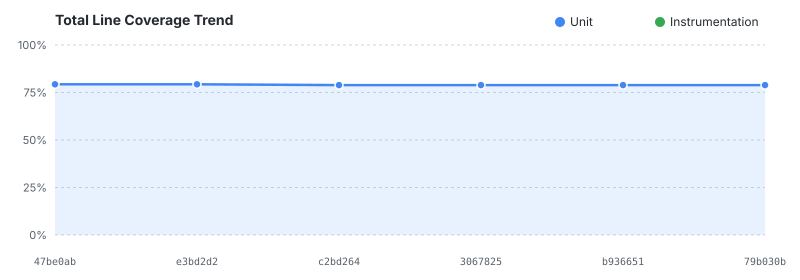
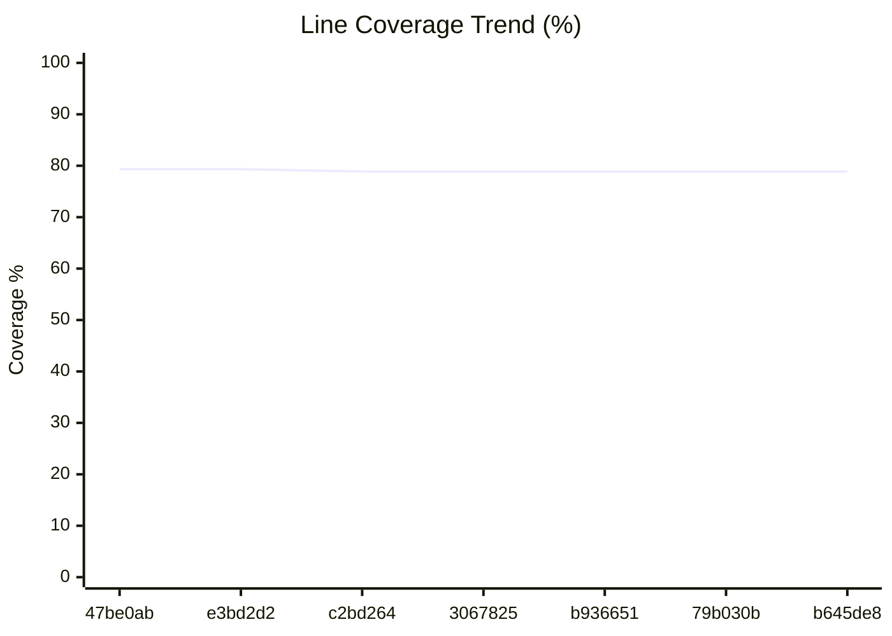

<!-- Generated by .github/scripts/coverage_history.py. Do not edit by hand. -->
# Test coverage

Raw data lives in [`history.csv`](history.csv), one row per module per
suite per merged commit. This page is regenerated from it and should not
be edited by hand.

The two suites are reported separately and are **not additive**. They
instrument different code with different runners, and merging them would
require combining the raw execution data rather than the XML reports.

> **What the instrumentation number measures.** It is dominated by
> `app`, which is the internal sample app, not a published artifact.
> It is *not* a direct measurement of the published `android-maps-testing`
> libraries. The library's code is exercised heavily by `app`'s tests,
> but coverage attributes to the module that runs the tests, so it
> is counted under `app`. Read the instrumentation figure as how
> much of the sample app, and through it the library, is exercised on a
> device. The unit table is the one that measures the published library
> modules directly.

## Current

### Unit tests

JVM tests run by `./gradlew koverXmlReportDebug`, covering the three published library modules (`robolectric-testing`, `golden-testing`, `visual-testing`).

Measured at `b645de8` (#6), recorded 2026-11-10T23:20:50Z.

| Module | Lines | Line % | | Branches | Branch % |
| --- | ---: | ---: | --- | ---: | ---: |
| `golden-testing` | 236/261 | 90.42% | `██████████████████░░` | 58/100 | 58.00% |
| `robolectric-testing` | 1,577/1,876 | 84.06% | `█████████████████░░░` | 333/642 | 51.87% |
| `visual-testing` | 110/301 | 36.54% | `███████░░░░░░░░░░░░░` | 84/335 | 25.07% |
| **TOTAL** | 1,923/2,438 | 78.88% | `████████████████░░░░` | 475/1,077 | 44.10% |

### Instrumentation tests

Emulator tests run by `./gradlew connectedAndroidTest`, covering the modules that own androidTest sources.

Measured at `79b030b` (#13), recorded 2026-11-10T15:56:09Z.

| Module | Lines | Line % | | Branches | Branch % |
| --- | ---: | ---: | --- | ---: | ---: |
| `app` | 180/225 | 80.00% | `████████████████░░░░` | 36/97 | 37.11% |
| **TOTAL** | 180/225 | 80.00% | `████████████████░░░░` | 36/97 | 37.11% |

## Trend (last 30 commits)

Total line coverage per suite, newest first.

| Date | Commit | PR | Unit % | Change | Instr. % | Change | Subject |
| --- | --- | --- | ---: | ---: | ---: | ---: | --- |
| 2026-11-10 | `b645de8` | #6 | 78.88% | 0.00 | n/a | n/a | fix: limit release-please version updates to this library's versions |
| 2026-11-10 | `79b030b` | #13 | 78.88% | 0.00 | 80.00% | n/a | chore(deps): bump actions/setup-java from 6.1.0 to 6.2.0 |
| 2026-11-04 | `b936651` | n/a | 78.88% | 0.00 | n/a | n/a | chore: align Maven coordinates and package namespaces to com.google.maps.android |
| 2026-11-03 | `3067825` | n/a | 78.88% | 0.00 | n/a | n/a | docs(skills): add testing paradigm skills and region-tagged references in .agents/skills |
| 2026-11-03 | `c2bd264` | n/a | 78.88% | -0.46 | n/a | n/a | feat: improve developer onboarding, KTX ergonomics, and cookbook docs |
| 2026-11-01 | `e3bd2d2` | n/a | 79.34% | 0.00 | n/a | n/a | chore: support Kotlin Power-Assert alternative, Version Catalog docs, and bump deps |
| 2026-11-01 | `47be0ab` | n/a | 79.34% | n/a | n/a | n/a | feat: initial release of Android Maps Testing Toolkit (1.0.0-rc01) |
