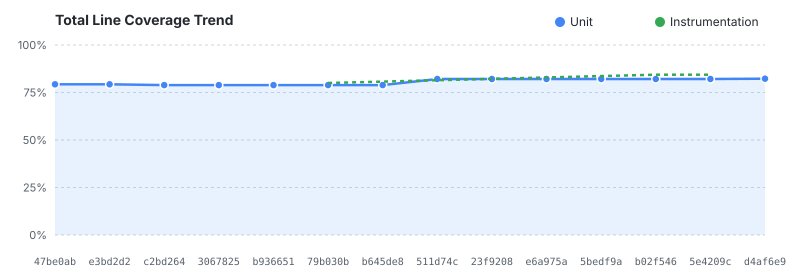
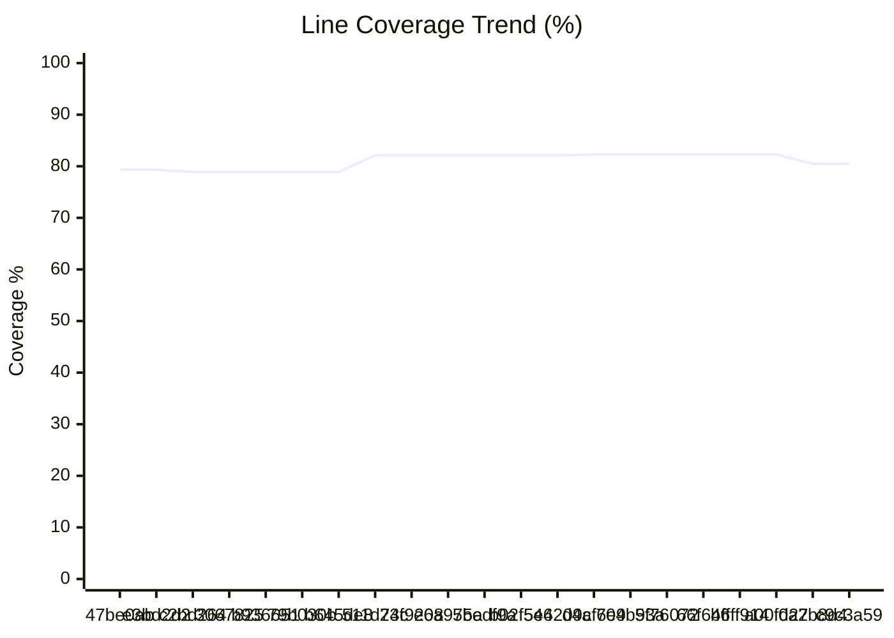

<!-- Generated by .github/scripts/coverage_history.py. Do not edit by hand. -->
# Test coverage

Raw data lives in [`history.csv`](history.csv), one row per module per
suite per merged commit. This page is regenerated from it and should not
be edited by hand.

The two suites are reported separately and are **not additive**. They
instrument different code with different runners, and merging them would
require combining the raw execution data rather than the XML reports.

> **What the instrumentation number measures.** It is dominated by
> `app`, which is the internal sample app, not a published artifact.
> It is *not* a direct measurement of the published `android-maps-testing`
> libraries. The library's code is exercised heavily by `app`'s tests,
> but coverage attributes to the module that runs the tests, so it
> is counted under `app`. Read the instrumentation figure as how
> much of the sample app, and through it the library, is exercised on a
> device. The unit table is the one that measures the published library
> modules directly.

## Current

### Unit tests

JVM tests run by `./gradlew koverXmlReportDebug`, covering the three published library modules (`robolectric-testing`, `golden-testing`, `visual-testing`).

Measured at `c9c3a59` (#28), recorded 2026-11-24T05:39:57Z.

| Module | Lines | Line % | | Branches | Branch % |
| --- | ---: | ---: | --- | ---: | ---: |
| `golden-testing` | 236/261 | 90.42% | `██████████████████░░` | 58/100 | 58.00% |
| `maps3d-robolectric-testing` | 364/508 | 71.65% | `██████████████░░░░░░` | 54/106 | 50.94% |
| `robolectric-testing` | 1,599/1,898 | 84.25% | `█████████████████░░░` | 333/642 | 51.87% |
| `visual-testing` | 199/313 | 63.58% | `█████████████░░░░░░░` | 122/347 | 35.16% |
| **TOTAL** | 2,398/2,980 | 80.47% | `████████████████░░░░` | 567/1,195 | 47.45% |

### Instrumentation tests

Emulator tests run by `./gradlew connectedAndroidTest`, covering the modules that own androidTest sources.

Measured at `c9c3a59` (#28), recorded 2026-11-24T05:40:03Z.

| Module | Lines | Line % | | Branches | Branch % |
| --- | ---: | ---: | --- | ---: | ---: |
| `app` | 194/230 | 84.35% | `█████████████████░░░` | 41/95 | 43.16% |
| **TOTAL** | 194/230 | 84.35% | `█████████████████░░░` | 41/95 | 43.16% |

## Trend (last 30 commits)

Total line coverage per suite, newest first.

| Date | Commit | PR | Unit % | Change | Instr. % | Change | Subject |
| --- | --- | --- | ---: | ---: | ---: | ---: | --- |
| 2026-11-24 | `c9c3a59` | #28 | 80.47% | 0.00 | 84.35% | 0.00 | ci: queue agent-leftovers runs instead of cancelling in-progress runs |
| 2026-11-24 | `0a2b8d4` | #30 | 80.47% | -1.81 | 84.35% | 0.00 | feat(maps3d): add maps3d-robolectric-testing module |
| 2026-11-23 | `a00fd27` | #32 | 82.28% | 0.00 | 84.35% | 0.00 | chore(deps): bump the gradle-minor-and-patch group with 5 updates |
| 2026-11-23 | `b6ff914` | #31 | 82.28% | 0.00 | 84.35% | 0.00 | chore(deps): bump the github-actions-minor-and-patch group with 2 updates |
| 2026-11-19 | `66f64ff` | #25 | 82.28% | 0.00 | 84.35% | +4.35 | chore: prepare 1.0.0-rc02 release |
| 2026-11-19 | `5f76072` | #24 | 82.28% | 0.00 | 80.00% | 0.00 | chore(deps): bump the gradle-minor-and-patch group across 1 directory with 10 updates |
| 2026-11-19 | `704b93a` | #23 | 82.28% | 0.00 | 80.00% | -4.35 | chore(deps): bump peter-evans/create-pull-request |
| 2026-11-19 | `d4af6e9` | #12 | 82.28% | +0.16 | 84.35% | 0.00 | feat(robolectric): add MapsRobolectricTestRunner and deprecate @EnableMapsShadows |
| 2026-11-19 | `5e4209c` | #9 | 82.12% | 0.00 | 84.35% | 0.00 | chore: rename root project and sample app away from the prototype names |
| 2026-11-19 | `b02f546` | #22 | 82.12% | 0.00 | 84.35% | n/a | fix(app): fit store locator camera onto displayed stores |
| 2026-11-13 | `5bedf9a` | #21 | 82.12% | 0.00 | n/a | n/a | chore(deps): bump Gradle wrapper to 9.9.1 |
| 2026-11-10 | `e6a975a` | #10 | 82.12% | 0.00 | n/a | n/a | chore: group dependabot minor and patch updates |
| 2026-11-10 | `23f9208` | #8 | 82.12% | 0.00 | n/a | n/a | build: stop keeping credential placeholders in gradle.properties |
| 2026-11-10 | `511d74c` | #7 | 82.12% | +3.24 | n/a | n/a | fix(visual): harden the Gemini golden fallback |
| 2026-11-10 | `b645de8` | #6 | 78.88% | 0.00 | n/a | n/a | fix: limit release-please version updates to this library's versions |
| 2026-11-10 | `79b030b` | #13 | 78.88% | 0.00 | 80.00% | n/a | chore(deps): bump actions/setup-java from 6.1.0 to 6.2.0 |
| 2026-11-04 | `b936651` | n/a | 78.88% | 0.00 | n/a | n/a | chore: align Maven coordinates and package namespaces to com.google.maps.android |
| 2026-11-03 | `3067825` | n/a | 78.88% | 0.00 | n/a | n/a | docs(skills): add testing paradigm skills and region-tagged references in .agents/skills |
| 2026-11-03 | `c2bd264` | n/a | 78.88% | -0.46 | n/a | n/a | feat: improve developer onboarding, KTX ergonomics, and cookbook docs |
| 2026-11-01 | `e3bd2d2` | n/a | 79.34% | 0.00 | n/a | n/a | chore: support Kotlin Power-Assert alternative, Version Catalog docs, and bump deps |
| 2026-11-01 | `47be0ab` | n/a | 79.34% | n/a | n/a | n/a | feat: initial release of Android Maps Testing Toolkit (1.0.0-rc01) |
