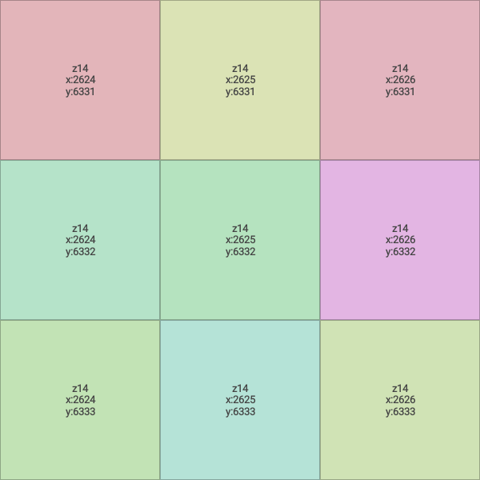
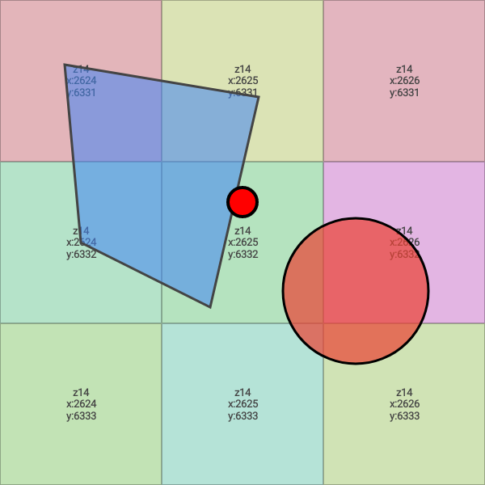
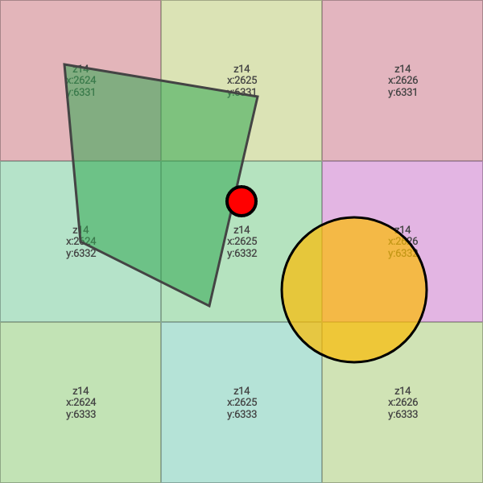
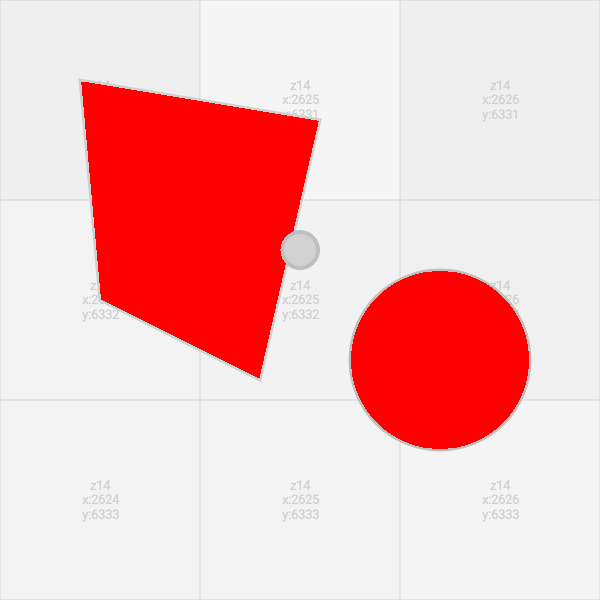

# Google Maps Android Golden Image Testing Library (`:golden-testing`)

Deterministic, offline screenshot and golden image testing for the Google Maps SDK on Android.

## Overview

Screenshot and visual regression testing on interactive Google Maps has traditionally been difficult or flaky due to:
1. **Network Latency & Quota**: Fetching real vector or satellite tiles from Google servers requires network connectivity, API key quota, and introduces non-deterministic load times.
2. **Server-Side Data Shifts**: Base map cartography updates over time (e.g. building footprints, seasonal road changes, copyright labels) can invalidate baseline golden images.
3. **Flaky CI Pipelines**: Headless CI environments often lack internet access or have unstable network latency, causing timeout failures.

This library solves these problems by switching Google Maps to `MAP_TYPE_NONE` and injecting an in-memory, deterministic synthetic tile provider (`GoldenTileProvider`).

```
+-------------------------------------------------------------+
|                      GoogleMap View                         |
|  +-------------------------------------------------------+  |
|  | User Overlays (Markers, Polygons, Polylines, Circles) |  | (z-index >= 0)
|  +-------------------------------------------------------+  |
|  | Synthetic Golden Tile Layer (GoldenTileProvider)      |  | (z-index = -1000)
|  | - Deterministic pastel/grid/solid colors              |  |
|  | - 100% offline, zero network, zero quota              |  |
|  +-------------------------------------------------------+  |
|  | Base Map Engine (MAP_TYPE_NONE)                       |  |
+-------------------------------------------------------------+
```

## Visual Gallery

| Strategy: CoordinateGrid | Strategy: SolidColorHash | Strategy: Checkerboard |
|:---:|:---:|:---:|
|  |  |  |

| Baseline Golden Reference | Visual Regression Simulation | GoldenImageDiff Output |
|:---:|:---:|:---:|
|  |  |  |

---

## Features

- **Zero Network / Offline**: Fully offline and quota-free.
- **Deterministic Tile Strategies**:
  - `GoldenTileStrategy.SolidColorHash`: Unique, deterministic solid colors per `(x, y, zoom)` tile.
  - `GoldenTileStrategy.CoordinateGrid`: Visual coordinate grid with tile bounds and `z/x/y` labels.
  - `GoldenTileStrategy.Checkerboard`: Alternating high-contrast checkerboard pattern.
  - `GoldenTileStrategy.Custom`: Custom lambda for full control over tile rasterization.
- **LRU In-Memory Caching**: High-performance LRU tile cache prevents repeated bitmap allocation and PNG encoding during camera animations and gestures.
- **Coroutine Snapshot Utilities**: Suspending extensions (`awaitMapLoaded()`, `captureSnapshot()`) for asynchronous test flows.
- **Flexible Diff Engine**: Pixel-by-pixel comparator with configurable tolerance percentage, per-channel color tolerance, and visual diff image generation highlighting regressions in red.
- **Jetpack Compose Support**: `rememberGoldenTileProvider()` helper for Maps Compose declarative applications.
- **Robolectric & Instrumented Compatible**: Runs identically in local JVM unit tests (via Robolectric Native Graphics) and on-device instrumented tests.

---

## Installation

### Using Gradle Version Catalog (`gradle/libs.versions.toml`) — Recommended

Add `:golden-testing` to your `gradle/libs.versions.toml`:

<!-- x-release-please-start-version -->
```toml
[versions]
mapsTesting = "1.0.0-rc01"

[libraries]
maps-testing-golden = { module = "com.google.android.maps.testing:golden", version.ref = "mapsTesting" }
```
<!-- x-release-please-end -->

Then add the dependency in your module's `build.gradle.kts`:

```kotlin
dependencies {
    testImplementation(libs.maps.testing.golden)
    // Or for on-device instrumented screenshot tests:
    androidTestImplementation(libs.maps.testing.golden)
}
```

<details>
<summary><b>Without Version Catalog (Direct Coordinates)</b></summary>

<!-- x-release-please-start-version -->
```kotlin
dependencies {
    testImplementation("com.google.android.maps.testing:golden:1.0.0-rc01")
    // Or for on-device instrumented screenshot tests:
    androidTestImplementation("com.google.android.maps.testing:golden:1.0.0-rc01")
}
```
<!-- x-release-please-end -->

</details>

---

## Quickstart

### 1. Enable Golden Testing on a Map

```kotlin
// Configure GoogleMap for deterministic golden testing
val tileOverlay = googleMap.enableGoldenTesting(
    strategy = GoldenTileStrategy.CoordinateGrid()
)

// Add your app's markers, polylines, or custom overlays
googleMap.addMarker(MarkerOptions().position(LatLng(37.7749, -122.4194)).title("Target"))
```

### 2. Capture and Assert Snapshots

```kotlin
// Wait for render pass to settle
googleMap.awaitMapLoaded()

// Capture map snapshot
val actualSnapshot = googleMap.captureSnapshot()

// Compare against expected baseline
GoldenImageDiff.assertMatches(
    expected = baselineBitmap,
    actual = actualSnapshot,
    maxDiffPercentage = 0.001 // 0.1% tolerance for anti-aliasing
)
```

### 3. Jetpack Compose Integration

```kotlin
GoogleMap(
    properties = MapProperties(mapType = MapType.NONE),
) {
    val tileProvider = rememberGoldenTileProvider(
        strategy = GoldenTileStrategy.CoordinateGrid()
    )
    TileOverlay(
        tileProvider = tileProvider,
        fadeIn = false,
        zIndex = -1000f,
    )

    // Your Compose markers and overlays
    Marker(state = rememberMarkerState(position = LatLng(37.7749, -122.4194)))
}
```

---

## License

```
Copyright 2026 Google LLC

Licensed under the Apache License, Version 2.0 (the "License");
you may not use this file except in compliance with the License.
You may obtain a copy of the License at

    http://www.apache.org/licenses/LICENSE-2.0

Unless required by applicable law or agreed to in writing, software
distributed under the License is distributed on an "AS IS" BASIS,
WITHOUT WARRANTIES OR CONDITIONS OF ANY KIND, either express or implied.
See the License for the specific language governing permissions and
limitations under the License.
```
